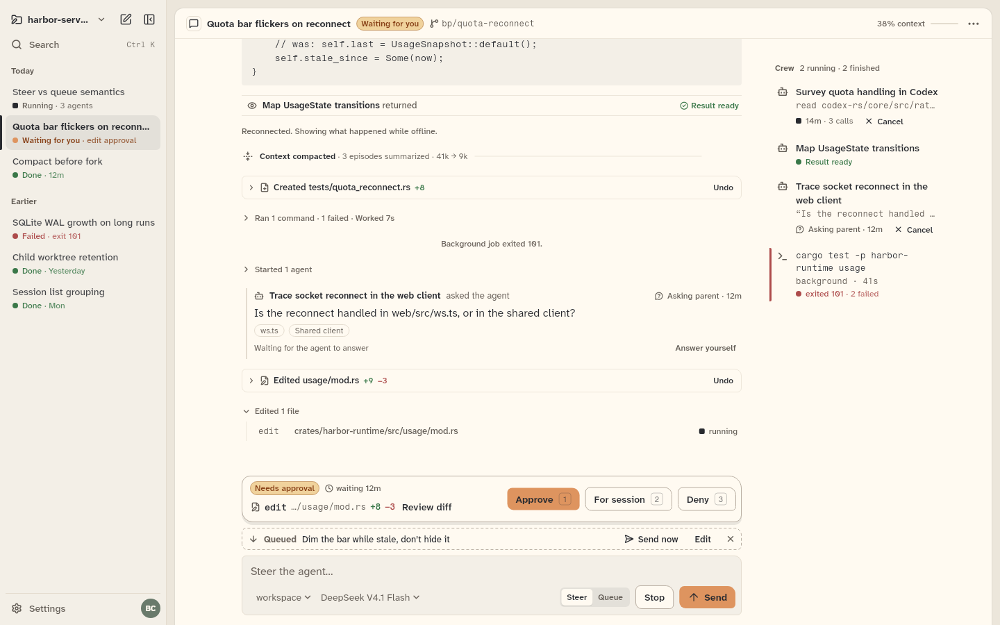
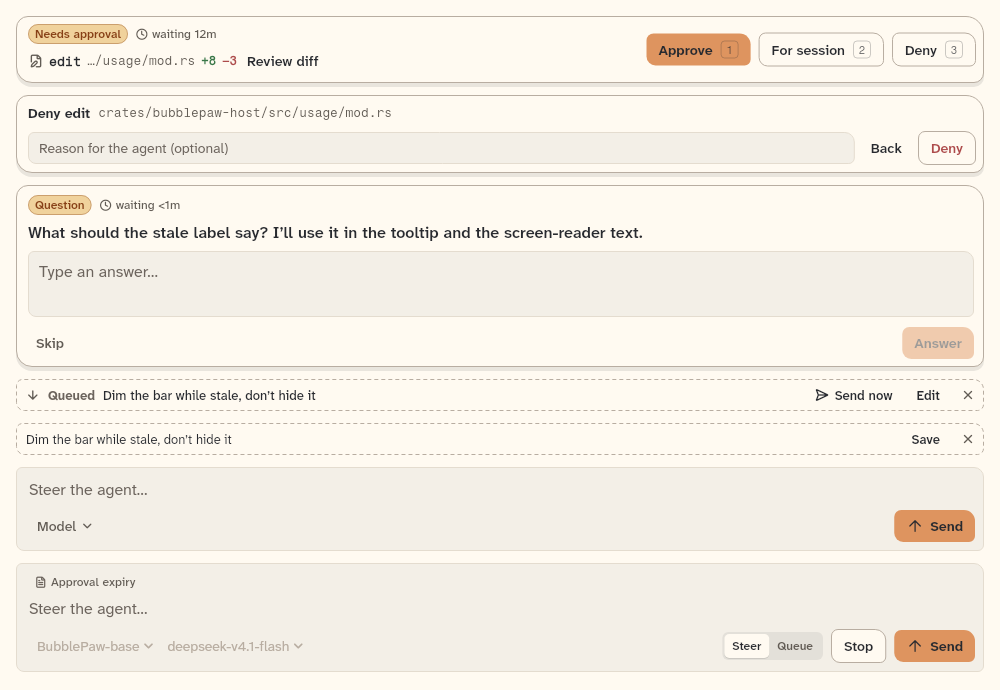
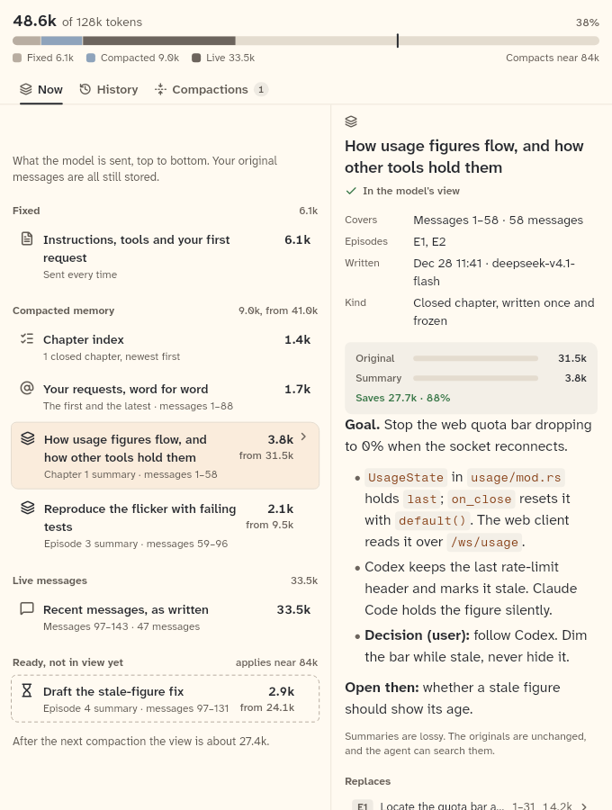
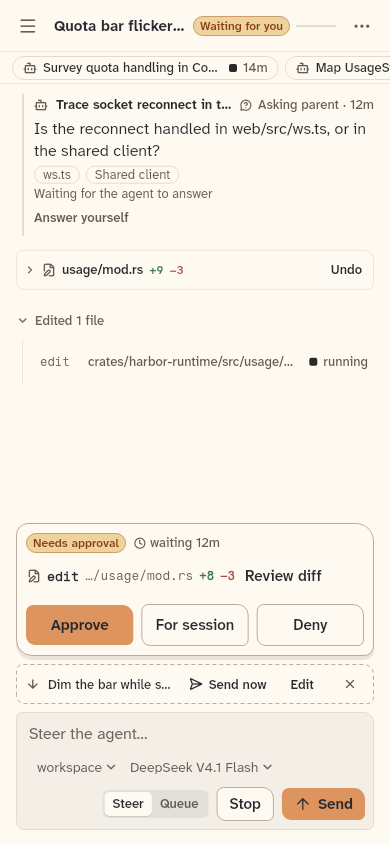
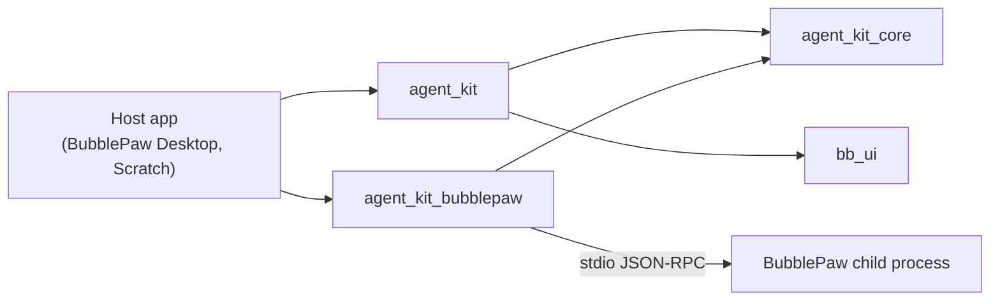

<p align="center">
  <picture>
    <source media="(prefers-color-scheme: dark)" srcset="design/readme/agent-kit-dark.svg">
    
  </picture>
</p>

<p align="center">Agent chat widgets and backend ports for BubbleBuffer apps.</p>

<picture>
  <source media="(prefers-color-scheme: dark)" srcset="design/readme/shots/workbench-dark.png">
  
</picture>

## What it is

- **Transcript.** Messages, activity and evidence rows, edits with a diff and undo, and the plan, drawn from plain view models.
- **Composer.** The input with steer or queue, an approval bar (approve, for session, deny), questions from the agent, and the queued-input row.
- **Context.** A meter bar of what the model is sent, a Now, History and Compactions pane, compaction markers, and cards for compacted history. The originals stay available.
- **Workspace and chrome.** A split tree of panes with docking and edge tabs, plus the rail, header and crew strip. Long chats get an outline of chapters with a where-am-I strip.
- **Two compositions.** `AgentChatPane` is one chat and `AgentWorkbench` is the whole workspace. Give either an `AgentBackend` and it maps every user action to a backend command.
- **A backend port, not a backend.** `agent_kit_core` holds the chat models, the `ChatReader` and `AgentBackend` ports, an event reducer over snapshots and events, typed command errors and a scripted backend, in pure Dart with no Flutter. Widgets read semantic roles from `BbTheme`, light and dark, in three size classes.

The agent UI in [BubblePaw Desktop](https://github.com/BubbleBuffer/BubblePaw-Desktop) and [Scratch](https://github.com/BubbleBuffer/Scratch) comes from this kit. Desktop uses all three packages; Scratch uses `agent_kit` and `agent_kit_core` for its chat outline and dev pane.

<p>
  <picture>
    <source media="(prefers-color-scheme: dark)" srcset="design/readme/shots/composer-dark.png">
    
  </picture>
  <picture>
    <source media="(prefers-color-scheme: dark)" srcset="design/readme/shots/context-dark.png">
    
  </picture>
  <picture>
    <source media="(prefers-color-scheme: dark)" srcset="design/readme/shots/phone-dark.png">
    
  </picture>
</p>

The shots are the gallery's golden tests, rendered on Linux CI with the bundled fonts.

## How it fits together



| Package | What it is |
|---|---|
| [`agent_kit_core`](packages/agent_kit_core) | Pure Dart chat models, the `ChatReader` and `AgentBackend` ports, capabilities and constraints, the event reducer, typed command errors and a scripted backend. |
| [`agent_kit`](packages/agent_kit) | Flutter agent UI: theme, status, transcript, composer, chrome, context, workspace and compositions. Depends on `agent_kit_core` and on [bb-ui](https://github.com/BubbleBuffer/bb-ui). |
| [`agent_kit_bubblepaw`](packages/agent_kit_bubblepaw) | Pure Dart backend that drives a BubblePaw child process over stdio JSON-RPC. |

[`apps/gallery`](apps/gallery) holds the agent scenes, the scripted backend, an optional live BubblePaw mode, and the fonts and goldens the tests use.

## Using and pinning

Depend on the widgets through Git. `agent_kit_core` comes with it, and `agent_kit` pins `bb_ui` itself.

```yaml
dependencies:
  agent_kit:
    git:
      url: https://github.com/BubbleBuffer/agent-kit.git
      ref: v0.15.1
      path: packages/agent_kit
```

For the BubblePaw adapter alone, use the same URL and ref with `path: packages/agent_kit_bubblepaw`. When a host declares several agent packages directly, pin every entry from this repository to the same full commit SHA, since Pub can treat a tag and a path dependency resolved at a SHA as different sources. A host that imports `bb_ui` directly declares the exact Git source `agent_kit` uses. Both rules, the release steps and the font setup are in [package layout and pinning](docs/package-layout.md).

## Build and test

Flutter `3.47.5` (stable). This is a Dart pub workspace; these are the commands CI runs.

```sh
flutter pub get
dart format --output=none --set-exit-if-changed .
flutter analyze
bash scripts/check-raw-colours.sh

# widget and gallery tests
(cd packages/agent_kit && flutter test --exclude-tags golden)
(cd apps/gallery && flutter test --exclude-tags golden)

# goldens: compare with the committed PNGs
(cd packages/agent_kit && flutter test --tags golden)
(cd apps/gallery && flutter test --tags golden)

# pure Dart packages
(cd packages/agent_kit_core && dart analyze --fatal-infos && dart test)
(cd packages/agent_kit_bubblepaw && dart analyze --fatal-infos && dart test)
```

The goldens are rendered by Linux CI. The adapter's workflow also checks it against a pinned public BubblePaw release.

## Documentation

The wiki is [`docs/`](docs/README.md): how the kit works now, package by package.

## Licence

`AGPL-3.0-or-later`, see [LICENSE](LICENSE). The bundled fonts in `apps/gallery/assets/fonts` keep their own OFL licences. agent-kit is made by [BubbleBuffer](https://0xbubbuff.de).
