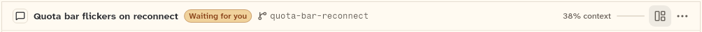
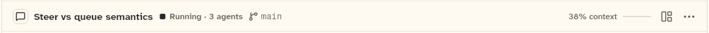
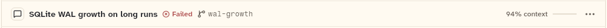
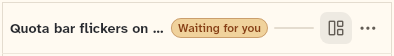

# ChatHeader

The bar at the top of a chat: the session's tile and title, its status pill, the branch, the context meter, the workspace toggle and the session menu. This sheet also covers ChromeMenuItem (one entry of the session menu).

```dart
import 'package:agent_kit/agent_kit.dart';
```

## Demo

<picture>
  <source media="(prefers-color-scheme: dark)" srcset="shots/chat_header_needs_you-dark.png">
  
</picture>

*Needs you, 1000 px: the chat's status is "needs you", shown as the warm pill.*

<picture>
  <source media="(prefers-color-scheme: dark)" srcset="shots/chat_header_running-dark.png">
  
</picture>

*Running, 1000 px: the status is Running, with the `statusDetail` "3 agents" beside it.*

<picture>
  <source media="(prefers-color-scheme: dark)" srcset="shots/chat_header_failed-dark.png">
  
</picture>

*Failed, 1000 px: the status is Failed. The usage carries 120000 context tokens of a 128000 limit, so the meter shows a near-full bar.*

<picture>
  <source media="(prefers-color-scheme: dark)" srcset="shots/chat_header_compact-dark.png">
  
</picture>

*Compact, 390 px: the narrow header. The tile, the branch and the meter label are dropped.*

## Parameters

| Parameter | Type | Notes |
|---|---|---|
| `chat` | `ChatSummary` | Required. The title and `status`. |
| `branch` | `String?` | The branch shown after the title. |
| `worktree` | `String?` | Shown in the branch's tooltip (`worktree ?? branch`). |
| `usage` | `Usage?` | The context tokens and limit for the meter. |
| `statusDetail` | `String?` | A line beside the status pill, such as "3 agents". |
| `workspaceShown` | `bool` | Default `false`. The state of the workspace toggle. |
| `onToggleWorkspace` | `VoidCallback?` | The workspace toggle. Hidden when null (key `header-workspace`). |
| `menuItems` | `List<ChromeMenuItem>` | Default `[]`. Entries of the session menu. |
| `hideEmptyMenu` | `bool` | Default `false`. Leaves the menu button out when `menuItems` is empty. |
| `onOpenContext` | `VoidCallback?` | Passed to the context meter. When set, the meter is a button. |

### ChromeMenuItem

| Parameter | Type | Notes |
|---|---|---|
| `label` | `String` | Required. The entry's text. |
| `onTap` | `VoidCallback` | Required. The entry's callback. |
| `glyph` | `LucideGlyph?` | An icon for the entry. |
| `danger` | `bool` | Default `false`. Draws the entry in the danger colour. |
| `separatorBefore` | `bool` | Default `false`. Draws a separator above the entry. |

## Theme roles

`BbTheme` roles read in `chat_header.dart`:

- `surface`, `seam`, `ink`, `muted`, `faint`, `hover`, `pressed`, `threadStrong`
- `radii.ctl`, `typeScale.ui`, `typeScale.uiSmall`, `formFactor`, `sizeMedium`
- `colors.borderSubtle` (the workspace toggle and menu edges)
- The status pill is a `StatusMark` (`status/status_mark.dart`) that reads the `status` styles for the chat's status.

## Size classes

- Narrow: `constraints.hasBoundedWidth && constraints.maxWidth < theme.sizeMedium` (600 px by default) (`chat_header.dart:85`). Narrow drops the tile, the branch and the meter label. The height is 52 px when narrow, and `Layout.topbarHeight` otherwise.
- Touch (`formFactor == mobile`): the meter button is 40 px high, otherwise 32 px (`ContextMeter`, `chat_header.dart:335`).
- The menu popover is 220 px wide (`_openMenu`).

## Accessibility

- The workspace toggle has key `header-workspace`.
- The session menu button has key `header-menu` and the label `Session menu`. Its tap is null when `menuItems` is empty.
- The context meter has the semantics label `<percent>% context used` (or `… Open the context view` when `onOpenContext` is set). Its tooltip is `Context: N%` or `Context: N% of <limit>`.
- The branch has a tooltip showing the worktree, or else the branch (`_Branch`).

## Gallery and tests

- Gallery scene: the Components scene (`apps/gallery/lib/src/components_scene.dart`). Specimens: `ChromeSpecimens` in `apps/gallery/lib/components/chrome.dart`: ChatHeader at 1000 px (needs you, running, failed, done) and at 390 px.
- Golden shots: `apps/gallery/test/component_shots_test.dart` writes `chat_header_needs_you`, `_running`, `_failed` and `_compact` to `apps/gallery/test/goldens/shots/`. `scenes_golden_test.dart` covers the sheet as `components_1000_light.png` and `components_1000_dark.png`.
- `packages/agent_kit/test/chrome/chrome_test.dart`: "wide: tile, title, pill, branch and the meter label", "narrow: drops the branch and the meter label", "a very long title truncates without overflowing", and "the workspace toggle and the session menu call back".
- `packages/agent_kit/test/chrome/chrome_golden_test.dart`: `chrome_header_1000_<brightness>.png` and `chrome_header_390_<brightness>.png` in `packages/agent_kit/test/goldens/`.
- `packages/agent_kit/test/context/context_pane_test.dart` mentions the meter.
