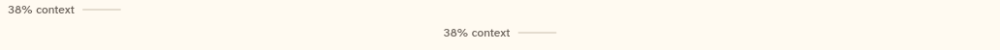
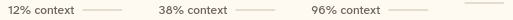

# ContextMeter

A bar and a percentage that show how much of the model's context window the chat uses. It is defined in `chat_header.dart` and is used inside ChatHeader.

```dart
import 'package:agent_kit/agent_kit.dart';
```

## Demo

<picture>
  <source media="(prefers-color-scheme: dark)" srcset="shots/context_meter_header-dark.png">
  
</picture>

*Header, 38%: two meters side by side. The first is a plain readout. The second has `onTap` set and is a button.*

<picture>
  <source media="(prefers-color-scheme: dark)" srcset="shots/context_meter_states-dark.png">
  
</picture>

*States: 12%, 38% and 96% with the label, then 38% as the bar only (`showLabel: false`). The bar-only frame is cut off at the right edge of the crop.*

## Parameters

| Parameter | Type | Notes |
|---|---|---|
| `fraction` | `double` | Required. The share of the window used. The bar clamps it to 0 to 1. |
| `contextTokens` | `int?` | Used in the tooltip with `contextLimit`. |
| `contextLimit` | `int?` | Used in the tooltip with `contextTokens`. |
| `showLabel` | `bool` | Default `true`. Shows the `N% context` label beside the bar. |
| `onTap` | `VoidCallback?` | Makes the meter a button. |

## Theme roles

`BbTheme` roles read in `chat_header.dart` for the meter:

- `threadStrong` (the fill), `seam` (the track), `ink`, `muted`, `faint`
- `hover` and `pressed` (the button overlays, when `onTap` is set)
- `formFactor` (touch height)

## Size classes

- Bar: 40 × 2 px (`chat_header.dart`, `ContextMeter`).
- Button height: 40 px on touch, 32 px otherwise.
- ChatHeader drops the label when it is narrow (below `sizeMedium`, 600 px by default).

## Accessibility

- Without `onTap`: the semantics label is `<percent>% context used`.
- With `onTap`: the meter is a button with the label `<percent>% context used. Open the context view`, and the hover key is `header-context`.
- Tooltip: `Context: N%`, or `Context: N% of <formatTokens(limit)>` when `contextLimit` is set.

## Gallery and tests

- Gallery scene: the Components scene (`apps/gallery/lib/src/components_scene.dart`). Specimens: `ContextSpecimens` in `apps/gallery/lib/components/context.dart` (the header readout and button, indices 0 and 1), and `ChromeSpecimens` in `apps/gallery/lib/components/chrome.dart` (the four states, 12%, 38%, 96%, 38% bar only).
- Golden shots: `apps/gallery/test/component_shots_test.dart` writes `context_meter_header` (ContextMeter 0 to 1) and `context_meter_states` (ContextMeter 12 to 15) to `apps/gallery/test/goldens/shots/`. `scenes_golden_test.dart` covers the sheet as `components_1000_light.png` and `components_1000_dark.png`.
- `packages/agent_kit/test/chrome/chrome_test.dart` and `packages/agent_kit/test/context/context_pane_test.dart` mention the meter. `chrome_golden_test.dart` covers it through the header goldens.
