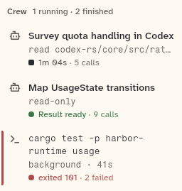
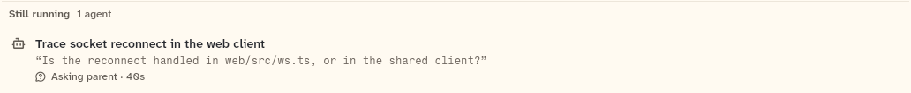

# CrewLedger

A list of the child agents and background jobs, with their status and a Cancel action for running agents. It draws nothing when there are no agents or jobs.

```dart
import 'package:agent_kit/agent_kit.dart';
```

## Demo

<picture>
  <source media="(prefers-color-scheme: dark)" srcset="shots/crew_ledger-dark.png">
  
</picture>

*Ledger, 252 px: the agents and jobs as rows, each with its status. Running agents show a Cancel button.*

<picture>
  <source media="(prefers-color-scheme: dark)" srcset="shots/crew_ledger_asking_parent-dark.png">
  
</picture>

*Asking parent: an agent waiting on its parent is listed with the asking-parent status.*

## Parameters

| Parameter | Type | Notes |
|---|---|---|
| `agents` | `List<ChildAgent>` | Default `[]`. The child agents. |
| `jobs` | `List<BackgroundJob>` | Default `[]`. The background jobs. |
| `now` | `DateTime?` | The clock for elapsed time. |
| `onOpenAgent` | `ValueChanged<ChildAgent>?` | Called when an agent row is tapped. |
| `onOpenJob` | `ValueChanged<BackgroundJob>?` | Called when a job row is tapped. |
| `onCancelAgent` | `ValueChanged<ChildAgent>?` | Cancel callback. Without it there is no Cancel button. |
| `cancelling` | `Set<String>` | Default `{}`. Ids of agents being cancelled. Their Cancel button reads `Cancelling…` and is disabled. |

## Theme roles

`BbTheme` roles read in `crew_ledger.dart`:

- `ink`, `muted`, `faint`, `hover`, `pressed`
- `dangerInk` (the failed-job edge bar)
- `colors.iconSecondary`, `radii.field`, `typeScale.ui`
- Each row's status is a `StatusMark` or `StatusMark.work` (`crew_ledger.dart:91`, `:118`). The Cancel button is `KitButton` (`composer_parts.dart`).

## Size classes

Does not read the size class. The ledger takes the width it is given.

## Accessibility

- A cancel button's tooltip is `Stops this agent and any agents it started`.
- Its label is `Cancel` (or `Cancelling…` while cancelling). Its semantics label is `Cancel <task>`, or `Cancelling <task>`.
- A failed job has a 3 px `dangerInk` edge bar.
- Keys: `ledger-agent-<id>`, `ledger-job-<id>`, `ledger-cancel-<id>`.

## Gallery and tests

- Gallery scene: the Components scene (`apps/gallery/lib/src/components_scene.dart`). Specimens: `ChromeSpecimens` in `apps/gallery/lib/components/chrome.dart` (CrewLedger at 252 px), and the asking-parent specimen in `apps/gallery/lib/components/context.dart`.
- Golden shots: `apps/gallery/test/component_shots_test.dart` writes `crew_ledger` (CrewLedger 1) and `crew_ledger_asking_parent` (CrewLedger 0 from the context specimens) to `apps/gallery/test/goldens/shots/`. `scenes_golden_test.dart` covers the sheet as `components_1000_light.png` and `components_1000_dark.png`.
- `packages/agent_kit/test/chrome/chrome_test.dart`: "the ledger counts, lists and opens its entries", "Cancel is offered on a running agent only", "without onCancelAgent there is no Cancel", and "a cancelling agent shows it and cannot be cancelled twice".
- `packages/agent_kit/test/chrome/chrome_golden_test.dart`: `chrome_crew_1000_<brightness>.png` and `chrome_crew_390_<brightness>.png` in `packages/agent_kit/test/goldens/`.
- `packages/agent_kit/test/compositions/agent_workbench_test.dart` (crew group) and `packages/agent_kit/test/transcript/child_question_test.dart` (asking parent group) mention the ledger.
