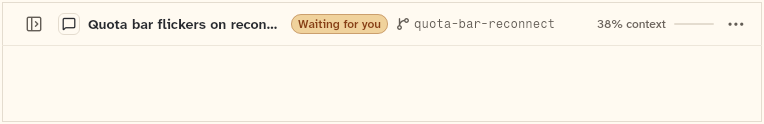

# RailLayout

The layout that places the session rail beside the chat: a column at medium and expanded widths, a sliding screen at compact width. This sheet also covers RailShowButton (the header button that brings the rail back), RailController (the show and hide state) and RailScope (what the layout passes down).

```dart
import 'package:agent_kit/agent_kit.dart';
```

## Demo

<picture>
  <source media="(prefers-color-scheme: dark)" srcset="shots/rail_layout_hidden-dark.png">
  
</picture>

*Hidden, 760 px wide: the controller is `hidden: true`, so the column is folded away and the show button is offered. The gallery frame is 120 px high.*

## Parameters

### RailLayout

| Parameter | Type | Notes |
|---|---|---|
| `controller` | `RailController` | Required. Holds the hidden and open state. |
| `rail` | `Widget` | Required. The rail (usually a `SessionRail`). |
| `child` | `Widget` | Required. The chat area. |

### RailShowButton

| Parameter | Type | Notes |
|---|---|---|
| `gap` | `double` | Default `8`. The space after the button, only when it shows. |
| `size` | `double` | Default `32`. The button size. |

### RailController

`RailController({bool hidden = false, bool open = false})` (the parameters are named `_hidden` and `_open` in the source; see the note below). It is a `ChangeNotifier`.

| Member | Type | Notes |
|---|---|---|
| `hidden` | `bool` | Medium and expanded: the column is folded away. |
| `open` | `bool` | Compact: the sliding screen is shown. |
| `isVisible(SizeClass)` | `bool` | Compact: `open`. Otherwise: `!hidden`. |
| `show(SizeClass)` / `hide(SizeClass)` | methods | Set `open` when compact, `hidden` otherwise. |
| `toggle(SizeClass)` | method | Hides when visible, shows when not. |

Note: the constructor parameters are written `this._hidden` and `this._open` (`rail_model.dart:21`). Call sites outside the library use `RailController(open: true)` and `RailController(hidden: true)` (`apps/gallery/lib/components/chrome.dart:303`, `:344`; `packages/agent_kit/test/chrome/chrome_golden_test.dart:150`, `:172`). This was not compiled here, so whether those calls build is unverified.

### RailScope

An `InheritedWidget` that `RailLayout` installs. It is read with `RailScope.maybeOf(context)`.

| Parameter | Type | Notes |
|---|---|---|
| `controller` | `RailController` | Required. |
| `sizeClass` | `SizeClass` | Required. The size class of the layout. |
| `visible` | `bool` | Required. Whether the rail shows. |
| `child` | `Widget` | Required. |

## Theme roles

`BbTheme` roles read in `rail_layout.dart`:

- `railLine` (the column's edge line)
- `RailShowButton` uses `ChromeIconButton` from `chrome_button.dart`, which reads `colors.iconSecondary`, `hover`, `pressed` and `radii.ctl`.
- `Motion.of(context).sheet` and `Motion.ease` for the column's width change (`rail_layout.dart`).

## Size classes

- `RailLayout` checks `sizeClass.isCompact` (`rail_layout.dart:46`). Compact shows the rail as a sliding screen (`FractionalTranslation` over the child). Otherwise the rail is a column.
- The column is `Layout.sidebarWidth` wide (`rail_layout.dart:117`). The value is 240.0 in `bb_tokens` (`tokens.dart:334`, in the `agent-kit-adapter` checkout). The worktree uses the bb_ui git dependency v0.6.0, which was not checked.
- The column animates its width with `TweenAnimationBuilder`, using `Motion.of(context).sheet` and `Motion.ease`.
- `RailShowButton` shows a `menu` glyph labelled `Sessions` at compact width, and a `panel left open` glyph labelled `Show sidebar` (shortcut `commandKeyHint('Ctrl+B')`) when the column is hidden. Otherwise it is `SizedBox.shrink()`. Outside a `RailLayout` it is also `SizedBox.shrink()` (`rail_layout.dart:178`).

## Accessibility

- Ctrl+B and Cmd+B toggle the rail, through `CallbackShortcuts` (`rail_layout.dart:67`, `:72`).
- The show button is labelled `Sessions` (compact) or `Show sidebar` (hidden), with the shortcut hint `Ctrl+B` (`commandKeyHint`, which shows `⌘` on macOS and iOS).
- The show button's key is `rail-show`.
- The column animation uses `Motion` durations. No reduced-motion check is in this file.

## Gallery and tests

- Gallery scene: the Components scene (`apps/gallery/lib/src/components_scene.dart`). Specimens: `ChromeSpecimens` in `apps/gallery/lib/components/chrome.dart`; the hidden frame is `_HiddenRail` (760 × 120, `RailController(hidden: true)`).
- Golden shot: `apps/gallery/test/component_shots_test.dart` writes `rail_layout_hidden` (RailLayout 1) to `apps/gallery/test/goldens/shots/`. `scenes_golden_test.dart` covers the sheet as `components_1000_light.png` and `components_1000_dark.png`.
- `packages/agent_kit/test/chrome/chrome_test.dart`: "the hide button folds the column and the show button …", "Ctrl+B toggles the rail", "compact: a sliding screen opened from the menu button and …", and "the controller keeps the two states apart".
- `packages/agent_kit/test/chrome/chrome_golden_test.dart`: `chrome_rail_hidden_1000_<brightness>.png` and `chrome_rail_compact_390_<brightness>.png` in `packages/agent_kit/test/goldens/`.
