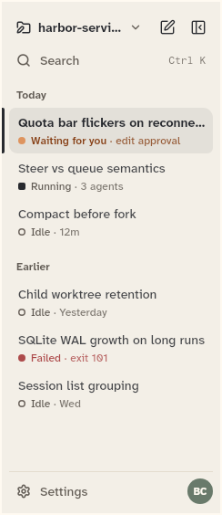
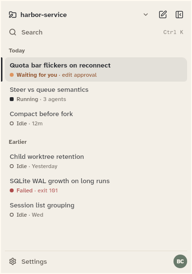

# SessionRail

The session list: the workspace header, the chats grouped under labelled headings, and a footer. This sheet also covers SessionRow (one chat in the list) and SessionGroup (the labelled run of chats in `rail_model.dart`).

```dart
import 'package:agent_kit/agent_kit.dart';
```

## Demo

<picture>
  <source media="(prefers-color-scheme: dark)" srcset="shots/session_rail_column-dark.png">
  
</picture>

*Column: the rail at 240 px wide, with grouped rows, a selected row, status marks and the footer.*

<picture>
  <source media="(prefers-color-scheme: dark)" srcset="shots/session_rail_compact-dark.png">
  
</picture>

*Compact, 390 px: the same rail as a sliding screen. It is opened by the header's Sessions button and closes when a session is picked.*

## Parameters

| Parameter | Type | Notes |
|---|---|---|
| `workspaceName` | `String` | Required. The name in the header, and in the Switch project label. |
| `groups` | `List<SessionGroup>` | Required. The chats, in groups. |
| `selectedId` | `String?` | The selected chat's id. The row is drawn selected. |
| `detailFor` | `String? Function(ChatSummary chat)?` | Returns the detail line for a chat's row. |
| `now` | `DateTime?` | The clock for row ages. |
| `initials` | `String` | Default `''`. Initials for the avatar. |
| `onSelect` | `ValueChanged<ChatSummary>?` | Called when a row is tapped. The compact screen closes after it. |
| `onNewChat` | `VoidCallback?` | The New session button. |
| `onSearch` | `VoidCallback?` | The Search button. |
| `onSwitchWorkspace` | `VoidCallback?` | The workspace button. |
| `onSettings` | `VoidCallback?` | The Settings button. |
| `onHide` | `VoidCallback?` | The Hide sidebar button. |
| `hasMore` | `bool` | Default `false`. Shows the load-more row at the end of the list. |
| `loadingMore` | `bool` | Default `false`. The load-more row shows its loading label and ignores presses. |
| `loadMoreFailed` | `bool` | Default `false`. The load-more row shows its failure label and offers another try. |
| `onLoadMore` | `VoidCallback?` | Called by the load-more row. |

### SessionGroup

| Parameter | Type | Notes |
|---|---|---|
| `label` | `String` | A heading such as "Today" or "Earlier". |
| `chats` | `List<ChatSummary>` | The chats in the group. |

### SessionRow

| Parameter | Type | Notes |
|---|---|---|
| `chat` | `ChatSummary` | Required. The chat: its title and `status`. |
| `detail` | `String?` | The meta line. |
| `selected` | `bool` | Default `false`. Draws the selected background and the edge bar. |
| `onTap` | `VoidCallback?` | Tap callback. |

## Theme roles

`BbTheme` roles read in `session_rail.dart`:

- `rail`, `railHover`, `railSelected`, `railInk`, `railMuted`, `railLine`
- `accent` (the avatar background when no moss space colour is found)
- `colors.bgPrimary`, `colors.textPrimary` (the avatar text)
- `dangerInk` (the failed load-more label)
- `radii.ctl`, `typeScale.ui`, `brightness`, `formFactor`
- The row's status mark uses `status` (`BbStatusStyle` per `ChatStatus`) through `StatusMark`.

## Size classes

- Compact (`scope.sizeClass.isCompact`, below 600 px): the rail is the sliding screen opened from the header's Sessions button. `select()` sets `scope.controller.open = false`, so the screen closes after a pick (`session_rail.dart:96`).
- Medium and expanded: the rail is the 240 px column (`Layout.sidebarWidth`, see RailLayout).
- The Search button's shortcut hint is shown when `formFactor != FormFactor.mobile` (`session_rail.dart:431`), and the Search button's hint is `Ctrl K` through `commandKeyHint`.

## Accessibility

- Button labels (tooltips and semantics): `New session` (`rail-new-chat`), `Hide sidebar` with shortcut Ctrl+B (`rail-hide`), `Switch project, <name>` (`rail-workspace`), `Search` with hint Ctrl K (`rail-search`), `Settings` (`rail-settings`).
- Load-more row (`rail-load-more`): `Loading older sessions…` while loading, `Could not load older sessions. Try again` after a failure, `Show older sessions` otherwise. Presses are ignored while loading.
- A selected row has a 3 px `railInk` edge bar and a title in weight 700 (unselected 500) (`SessionRow`).
- Row keys: `rail-row-<chat id>`.

## Gallery and tests

- Gallery scene: the Components scene (`apps/gallery/lib/src/components_scene.dart`). Specimens: `ChromeSpecimens` in `apps/gallery/lib/components/chrome.dart` (the 240 px column is the first frame; the 390 px sliding screen is `_SlidingRail`).
- Golden shots: `apps/gallery/test/component_shots_test.dart` writes `session_rail_column` (SessionRail 0) and `session_rail_compact` (SessionRail 1) to `apps/gallery/test/goldens/shots/`. `scenes_golden_test.dart` covers the sheet as `components_1000_light.png` and `components_1000_dark.png`.
- `packages/agent_kit/test/chrome/chrome_test.dart`, group `SessionRail`: groups, rows with status meta and the footer; the load-more row; "says it is loading and ignores presses meanwhile"; "after a failure the row offers another try"; and the compact sliding screen.
- `packages/agent_kit/test/chrome/chrome_golden_test.dart`: `chrome_rail_<brightness>.png`, `chrome_rail_more_<brightness>.png` and `chrome_rail_compact_390_<brightness>.png` in `packages/agent_kit/test/goldens/`.
- `packages/agent_kit/test/chrome/chrome_test.dart` (group `command key hints`) covers the hint text.
