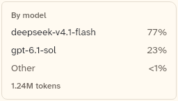

# UsageByModel

A list of the models used in a chat, with each model's share of the tokens and a total. It also covers ModelUsage, one model and its token count.

```dart
import 'package:agent_kit/agent_kit.dart';
```

## Demo

<picture>
  <source media="(prefers-color-scheme: dark)" srcset="shots/usage_by_model-dark.png">
  
</picture>

*By model, 252 px: two models and the folded row. The gallery data has a third model under 1% of the total, which folds into "Other" and shows as `<1%`. The footer shows the input and output token total.*

## Parameters

### UsageByModel

| Parameter | Type | Notes |
|---|---|---|
| `models` | `List<ModelUsage>` | Required. Each model and its tokens. |
| `usage` | `Usage?` | Input and output tokens for the footer. The footer shows only when both are non-null. |
| `title` | `String` | Default `'By model'`. The heading. |

### ModelUsage

| Parameter | Type | Notes |
|---|---|---|
| `model` | `String` | The model's name. |
| `tokens` | `int` | The model's token count. |

## Theme roles

`BbTheme` roles read in `usage_view.dart`:

- `ink`, `muted`, `faint`
- `seam` (the bar track), `surface`
- `radii.field`, `typeScale.ui`, `typeScale.uiSmall`

## Size classes

Does not read the size class. Models under 1% of the total fold into `Other`, shown as `<1%`. A total of 0 shows `No usage yet`. The footer reads `<formatTokens(input + output)> tokens`.

## Accessibility

- The view is a container with the semantics label of its `title` (`usage_view.dart:71`).

## Gallery and tests

- Gallery scene: the Components scene (`apps/gallery/lib/src/components_scene.dart`). Specimens: `ChromeSpecimens` in `apps/gallery/lib/components/chrome.dart` (UsageByModel at 252 px, with models flash 960000, sol 280000 and nano 4000).
- Golden shot: `apps/gallery/test/component_shots_test.dart` writes `usage_by_model` (UsageByModel 0) to `apps/gallery/test/goldens/shots/`. `scenes_golden_test.dart` covers the sheet as `components_1000_light.png` and `components_1000_dark.png`.
- `packages/agent_kit/test/chrome/chrome_test.dart`: "shares by model with the small ones folded" and "says so when there is no usage".
- `packages/agent_kit/test/chrome/chrome_golden_test.dart`: the crew and header goldens include the strip; the usage view has no golden of its own.
- `packages/agent_kit/test/compositions/agent_workbench_test.dart` mentions the view.
