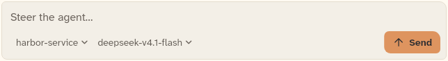
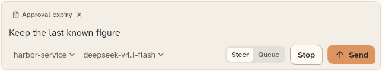
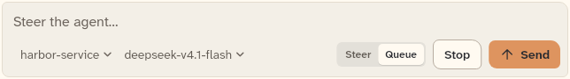
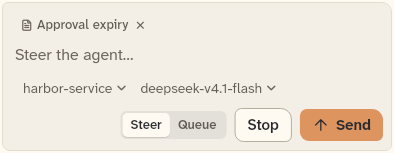

# AgentComposer

The message field and send bar at the foot of a chat. This sheet also covers its parts: ComposerModeToggle, ComposerRefChip, ComposerPick and the mention source types (MentionSource, StaticMentionSource, MentionRowLook).

```dart
import 'package:agent_kit/agent_kit.dart';
```

## Demo

<picture>
  <source media="(prefers-color-scheme: dark)" srcset="shots/agent_composer_idle-dark.png">
  
</picture>

*Idle: the composer at 640 px with no turn running. The bar shows Send and no Stop.*

<picture>
  <source media="(prefers-color-scheme: dark)" srcset="shots/agent_composer_steer-dark.png">
  
</picture>

*Running, Steer mode: a turn is running, so Stop shows. The field holds a reference chip and typed text.*

<picture>
  <source media="(prefers-color-scheme: dark)" srcset="shots/agent_composer_queue-dark.png">
  
</picture>

*Running, Queue mode: the mode is set to Queue, so submits are queued instead of steered.*

<picture>
  <source media="(prefers-color-scheme: dark)" srcset="shots/agent_composer_phone-dark.png">
  
</picture>

*Phone, 390 px: a compact bar. The pick menus move to their own line above the buttons.*

## Parameters

| Parameter | Type | Notes |
|---|---|---|
| `onSubmit` | `FutureOr<bool> Function(ComposerSubmission)` | Required. Receives the submission. When it returns `false`, the text and mentions are kept. |
| `running` | `bool` | Default `false`. While true, Stop shows and submits use the running delivery (steer or queue, by mode). |
| `onStop` | `VoidCallback?` | Stop button callback. Stop is disabled when null. |
| `canSend` | `bool` | Default `true`. When false, submitting does nothing. |
| `models` | `List<KitChoice>` | Default `[]`. Choices for the model pick. |
| `modelId` | `String?` | The selected model id. |
| `onModelChanged` | `ValueChanged<KitChoice>?` | Called when a model is picked. |
| `showModelPick` | `bool` | Default `true`. Shows the model pick. |
| `modelTitle` | `String` | Default `'Model'`. The pick's title. |
| `workspaces` | `List<KitChoice>` | Default `[]`. Choices for the workspace pick. |
| `workspaceId` | `String?` | The selected workspace id. |
| `onWorkspaceChanged` | `ValueChanged<KitChoice>?` | Called when a workspace is picked. |
| `workspaceTitle` | `String` | Default `'Workspace'`. The pick's title. |
| `workspaceLocked` | `bool` | Default `false`. Locks the workspace pick. |
| `refs` | `List<KitRef>` | Default `[]`. Reference chips shown above the field. |
| `onRemoveRef` | `ValueChanged<KitRef>?` | Called from a chip's remove button. |
| `chipMaxWidth` | `double` | Default `280`. Maximum width of a chip. |
| `chipKeyOf` | `Key Function(KitRef)?` | Gives each chip a key. |
| `mentions` | `MentionSource?` | Source for the `@` menu. Without it there is no menu. |
| `maxMentions` | `int` | Default `8`. Limit on the mention candidates. |
| `mentionLook` | `MentionRowLook Function(BuildContext, KitRef)?` | Row look for a candidate. |
| `mentionSectionOf` | `String? Function(KitRef)?` | Section heading for a candidate. |
| `onMentionPicked` | `ValueChanged<KitRef>?` | Called when a candidate is picked. |
| `mode` | `ComposerMode` | Default `ComposerMode.steer`. |
| `onModeChanged` | `ValueChanged<ComposerMode>?` | Called from the mode toggle. |
| `showModeToggle` | `bool` | Default `true`. When false, the send label while running is `runningSendLabel`. |
| `runningSendLabel` | `String` | Default `'Send'`. Used while running when `showModeToggle` is false. |
| `placeholder` | `String` | Default `'Steer the agent…'`. |
| `maxLines` | `int` | Default `8`. |
| `autofocus` | `bool` | Default `false`. |
| `controller` | `TextEditingController?` | Field controller. The widget makes its own when null. |
| `focusNode` | `FocusNode?` | Field focus node. |
| `keys` | `ComposerKeys` | Default `ComposerKeys()`. Keys for the parts of the bar. |

### ComposerModeToggle

Two segments, Steer and Queue, for the composer's `mode`.

| Parameter | Type | Notes |
|---|---|---|
| `mode` | `ComposerMode` | Required. The selected segment. |
| `onChanged` | `ValueChanged<ComposerMode>` | Required. Called with the picked mode. |

### ComposerRefChip

One reference chip above the field.

| Parameter | Type | Notes |
|---|---|---|
| `ref` | `KitRef` | Required. The reference the chip shows. |
| `onRemove` | `VoidCallback?` | The chip's remove button callback. |
| `maxWidth` | `double` | Default `280`. |

### ComposerPick

A pick button that opens a menu of choices.

| Parameter | Type | Notes |
|---|---|---|
| `title` | `String` | Required. The menu header and the semantics label. |
| `choices` | `List<KitChoice>` | Required. The choices. |
| `onSelected` | `ValueChanged<KitChoice>` | Required. Called with the picked choice. |
| `selectedId` | `String?` | The selected choice. |
| `placeholder` | `String?` | Text shown when nothing is selected. |

### Mention sources

| Type | Members | Notes |
|---|---|---|
| `MentionSource` (abstract interface) | `String get trigger`; `Future<List<KitRef>> suggest(String query)` | The host implements it. `trigger` is the character that opens the menu. |
| `StaticMentionSource` | `StaticMentionSource(List<KitRef> refs, {String trigger = '@'})` | Filters a fixed list by the query, case-insensitively. |
| `MentionRowLook` | `{Widget? leading, String? label, bool firstLine = false}` | Optional look for a menu row. |

## Theme roles

`BbTheme` roles read in `agent_composer.dart`, and in `composer_parts.dart` where the bar's buttons and surface come from:

- `surface`, `ink`, `muted`, `pressed`, `typeScale.uiSmall`, `radii.md` (`agent_composer.dart`)
- `accent`, `accentHover`, `onAccent`, `hover`, `dangerInk`, `seam`, `thread`, `typeScale.ui`, `layout.controlHeight`, `radii.sm`, `radii.md`, `radii.ctl`, `radii.panel`, `formFactor` (`composer_parts.dart`)
- `colors` (the bb-ui palette): `bgSecondary`, `iconSecondary`, `iconTertiary`, `textPrimary`, `textSecondary`, `textTertiary`, `textSelection`, `palette.lift` (`agent_composer.dart`)

## Size classes

- The bar checks `constraints.hasBoundedWidth && SizeClass.forWidth(constraints.maxWidth).isCompact` (`agent_composer.dart:642`). When compact and there are picks, the picks sit on their own line.
- Compact is below `sizeMedium` (600 px by default; see `theme/size_class.dart`).
- The mention menu is 324 px wide and 168 px high on non-mobile forms (`_MentionMenu`, `agent_composer.dart:914`).
- Touch form factor (`isTouch`) uses 40 px controls, otherwise `layout.controlHeight`.

## Accessibility

- The field is labelled `Message to the agent` (`_Field`, `agent_composer.dart`).
- Each reference chip's remove button has the semantics label `Remove context`.
- `ComposerPick` has the semantics label `"$title: $text"` (`composer_pick.dart`).
- The mention menu shows the header `No results` when there are no candidates.
- Keys: Enter sends, or steers while running; Shift+Enter does not send; Ctrl+Enter queues while running (tests: `agent_composer_test.dart`). In the mention menu, the arrow keys move and Enter picks.

## Gallery and tests

- Gallery scene: the Components scene (`apps/gallery/lib/src/components_scene.dart`). Specimens: `ComposerSpecimens` in `apps/gallery/lib/components/composer.dart`.
- Golden shots: `apps/gallery/test/component_shots_test.dart` writes `agent_composer_idle`, `_steer`, `_queue` and `_phone` to `apps/gallery/test/goldens/shots/` (light and dark). `apps/gallery/test/scenes_golden_test.dart` covers the whole sheet as `components_1000_light.png` and `components_1000_dark.png`.
- `packages/agent_kit/test/composer/agent_composer_test.dart`: the placeholder, Enter, Shift+Enter, running delivery, Stop, the compact layout, reference chips, the `@` menu, `No results`, and `onSubmit` returning false.
- `packages/agent_kit/test/composer/composer_golden_test.dart`: `packages/agent_kit/test/goldens/composer_1000_*.png` and `composer_390_*.png`.
- `packages/agent_kit/test/composer/composer_harness.dart`: the shared harness; it uses `StaticMentionSource`.
- `packages/agent_kit/test/compositions/agent_chat_pane_test.dart`: mentions the composer.
