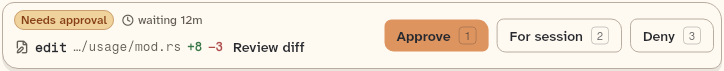
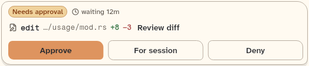
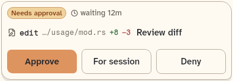
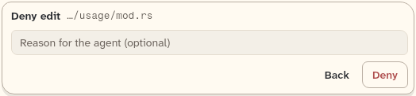

# ApprovalBar

The bar above the composer that asks the user to approve or deny a tool call, with the sibling ApprovalKeyPane (the focus marker that decides which bar answers the keys).

```dart
import 'package:agent_kit/agent_kit.dart';
```

## Demo

<picture>
  <source media="(prefers-color-scheme: dark)" srcset="shots/approval_bar_expanded-dark.png">
  
</picture>

*Expanded, 720 px: the request on the left, the Approve, For session and Deny buttons on the right, with key hints 1, 2 and 3.*

<picture>
  <source media="(prefers-color-scheme: dark)" srcset="shots/approval_bar_medium-dark.png">
  
</picture>

*Medium, 520 px: the bar is below the 600 px compact threshold, so the three buttons sit in equal widths under the request, with no key hints. The gallery frame is labelled "actions under the request"; the code uses the compact layout here.*

<picture>
  <source media="(prefers-color-scheme: dark)" srcset="shots/approval_bar_phone-dark.png">
  
</picture>

*Phone, 390 px: the compact layout. The three buttons are equal width and have no key hints.*

<picture>
  <source media="(prefers-color-scheme: dark)" srcset="shots/approval_bar_deny-dark.png">
  
</picture>

*Deny: after Deny is pressed, the bar shows the optional reason field in place of the three buttons.*

## Parameters

| Parameter | Type | Notes |
|---|---|---|
| `approval` | `Approval` | Required. The request: its tool, target, diff, arguments and `requestedAt`. |
| `onDecide` | `ValueChanged<ApprovalDecision>` | Required. Called with approve, approve for session, or deny (with the optional reason). |
| `onReview` | `VoidCallback?` | Review diff callback. The button shows only when the request has a diff and this is set. |
| `now` | `DateTime?` | The clock for the "waiting" age. When null, `WaitingLabel` refreshes every 30 s. |
| `composerEmpty` | `bool Function()?` | Lets the keys 1, 2 and 3 fire while the composer is empty. |
| `initiallyDenying` | `bool` | Default `false`. Starts with the deny reason field open. |
| `captureKeys` | `bool` | Default `true`. When false, the keys 1, 2 and 3 are ignored. |
| `enabled` | `bool` | Default `true`. |

### ApprovalKeyPane

A focus marker. Its `ApprovalKeyPane` wraps a pane of the workspace; only the focused pane's bar answers the keys when several panes show approvals (test: "with two panes only the focused pane's bar answers").

## Theme roles

`BbTheme` roles read in `approval_bar.dart`:

- `ink`, `muted`, `constructiveInk` (the `+added` count), `dangerInk` (the `−removed` count), `radii.field`, `typeScale.body` (touch), `typeScale.ui`
- `colors.borderSubtle` (the Details divider)
- The pill is a `StatusMark` with `ChatStatus.needsYou` (`status/status_mark.dart`), which reads the `needsYou` status style.

## Size classes

- Compact is `size.isCompact` (below 600 px). Compact shows the three buttons equal width under the request, and drops the key hints (`approval_bar.dart:256`).
- Not compact: key hints `1`, `2` and `3` show on the buttons (`keyHint: size.isCompact ? null : '1'`). Key hints also hide on touch (`KitButton`).
- The `_WrapActs` layout puts the actions under the request when the request area is narrower than `_minWhat` (280 px) (`approval_bar.dart:573`).
- In the compact layout the target is shortened with `shortenPath` (`approval_bar.dart:345`).

## Accessibility

- The keys 1, 2 and 3 fire Approve, For session and Deny when focus is outside a text field, inside the bar but outside the reason field, or when the composer is empty (`ApprovalBar` doc comment). Esc in the reason field returns to the three buttons; Enter in the reason field denies.
- The reason field's semantics and the buttons' labels come from `KitButton` (`semanticLabel`).
- Tests: "the keys 1, 2 and 3 fire the actions", "Esc in the reason field goes back to the three buttons", "with two panes only the focused pane's bar answers".

## Gallery and tests

- Gallery scene: the Components scene (`apps/gallery/lib/src/components_scene.dart`). Specimens: the ApprovalBar frames in `apps/gallery/lib/components/composer.dart`.
- Golden shots: `apps/gallery/test/component_shots_test.dart` writes `approval_bar_expanded`, `_medium`, `_phone` and `_deny` to `apps/gallery/test/goldens/shots/`. `scenes_golden_test.dart` covers the sheet as `components_1000_light.png` and `components_1000_dark.png`.
- `packages/agent_kit/test/composer/approval_bar_test.dart`: the pill and age, Review diff, the keys, Deny with reason, the compact layout, narrow actions, two panes, and Details.
- `packages/agent_kit/test/composer/composer_golden_test.dart`: the composer goldens include the bar.
- `packages/agent_kit/test/compositions/agent_chat_pane_test.dart`: mentions the bar.
