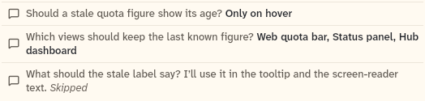

# QuestionAnswerLines

The resolved question as it reads in the transcript: one line per question, with the answer or "Skipped". It also has the top-level function `answerSummary`.

```dart
import 'package:agent_kit/agent_kit.dart';
```

## Demo

<picture>
  <source media="(prefers-color-scheme: dark)" srcset="shots/question_answer_lines-dark.png">
  
</picture>

*Answered: the resolved request, one line per question. Each line shows the question in muted text and the answer in bold.*

## Parameters

| Parameter | Type | Notes |
|---|---|---|
| `question` | `Question` | Required. The resolved request. Items with no answer show "Skipped", or "No answer" when the request is not `answered` (expired or cancelled). |

### answerSummary

`String? answerSummary(QuestionItem item, QuestionAnswer? answer)` joins the chosen labels and the typed text with commas. It returns null for a skipped item or no answer, and `'None'` when the answer has neither choices nor text.

## Theme roles

`BbTheme` roles read in `question_answered.dart`:

- `muted` (question text), `ink` (answer), `faint` (Skipped and No answer)
- `typeScale.uiSmall`
- `colors.borderSubtle` (the line divider)

## Size classes

Does not read the size class. The text size is 14 px on touch and 13 px otherwise (`question_answered.dart:76`).

## Accessibility

- The whole list has the semantics label `Answered questions`.
- Each line has the semantics label `"<question text> <answer or No answer or Skipped>"`, and excludes its child semantics.

## Gallery and tests

- Gallery scene: the Components scene (`apps/gallery/lib/src/components_scene.dart`). Specimen: the answered-lines frame in `ComposerSpecimens` (`apps/gallery/lib/components/composer.dart`).
- Golden shot: `apps/gallery/test/component_shots_test.dart` writes `question_answer_lines` (`QuestionAnswerLines` index 0) to `apps/gallery/test/goldens/shots/`. `scenes_golden_test.dart` covers the sheet as `components_1000_light.png` and `components_1000_dark.png`.
- `packages/agent_kit/test/composer/question_answered_test.dart`: "one line per question: answer, skipped" and "answerSummary joins choices and typed text".
- `packages/agent_kit/test/composer/question_golden_test.dart`: the question goldens.
- `packages/agent_kit/test/compositions/agent_chat_pane_test.dart` mentions the lines.
