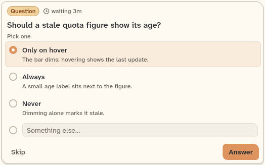
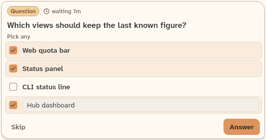
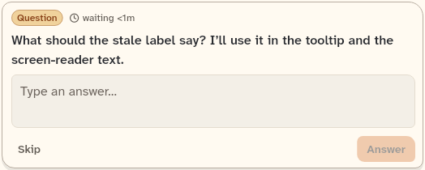
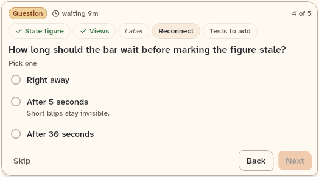
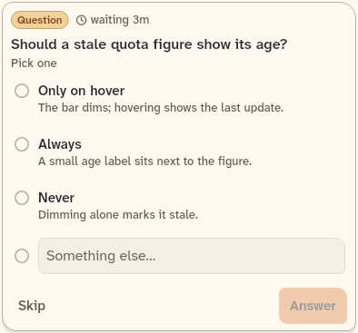

# QuestionPrompt

The card above the composer that asks the user one or more questions and sends the answers. Its option rows, "Something else" row, text answer and skip button are private parts of the same file.

```dart
import 'package:agent_kit/agent_kit.dart';
```

## Demo

<picture>
  <source media="(prefers-color-scheme: dark)" srcset="shots/question_prompt_pick_one-dark.png">
  
</picture>

*Pick one, 520 px: one question with a single-choice option set. Selection is exclusive, and Answer waits for a choice.*

<picture>
  <source media="(prefers-color-scheme: dark)" srcset="shots/question_prompt_pick_any-dark.png">
  
</picture>

*Pick any, 520 px: the same card with a multi-choice question. Several options can be ticked.*

<picture>
  <source media="(prefers-color-scheme: dark)" srcset="shots/question_prompt_text-dark.png">
  
</picture>

*Text only, 520 px: a question with no options, answered in the text field ("Type an answer…").*

<picture>
  <source media="(prefers-color-scheme: dark)" srcset="shots/question_prompt_steps-dark.png">
  
</picture>

*Steps, 520 px: a five-question request at step 3. The tabs show the step, the footer has Back, and the primary button reads Next until the last step.*

<picture>
  <source media="(prefers-color-scheme: dark)" srcset="shots/question_prompt_phone-dark.png">
  
</picture>

*Phone, 390 px: the option rows at compact width. The number hints are hidden.*

## Parameters

| Parameter | Type | Notes |
|---|---|---|
| `question` | `Question` | Required. The request: its items, their kinds and options, and `requestedAt`. |
| `onAnswer` | `ValueChanged<Map<String, QuestionAnswer>>` | Required. Called with one answer per item id when the last step is answered. |
| `now` | `DateTime?` | The clock for the age. When null, `WaitingLabel` refreshes every 30 s. |
| `composerEmpty` | `bool Function()?` | Lets the digit keys act while the composer is empty. |
| `captureKeys` | `bool` | Default `true`. When false, the digit keys are ignored. |
| `initialStep` | `int` | Default `0`. The step shown first. |
| `initialAnswers` | `Map<String, QuestionAnswer>` | Default `{}`. Answers to start from. |

## Theme roles

`BbTheme` roles read in `question_prompt.dart`:

- `ink`, `muted`, `faint`, `seam`, `surface`, `hover`, `accent`, `onAccent`, `focus`, `constructiveInk`
- `radii.md`, `radii.pill`, `typeScale.body`, `typeScale.ui`, `typeScale.uiSmall`
- `colors.bgSelectedBlock`, `colors.borderStrong`, `colors.borderSubtle`, `colors.textSelection`

## Size classes

- `hideKeys = touch || size.isCompact` (`question_prompt.dart:455`). The number hints are hidden on touch and below 600 px.
- Touch uses 40 px controls for the option rows and 32 px for the tabs; desktop uses 28 px (the skip button) and 26 px (tabs) (`question_prompt.dart:569`, `:1021`).

## Accessibility

- Option rows: Space selects; Up and Down move focus between rows (`_OptionRow`).
- The "Something else" row has the semantics label `Other answer` (`_OtherRow`).
- The text answer field has the placeholder `Type an answer…` (`_TextAnswer`).
- Digits 1 to 9 select options, and Enter sends (test: "number keys select, Enter sends").
- Keyboard, digit and Enter handling is off when `captureKeys` is false.

## Gallery and tests

- Gallery scene: the Components scene (`apps/gallery/lib/src/components_scene.dart`). Specimens: the QuestionPrompt frames in `apps/gallery/lib/components/composer.dart`, including the five-question request.
- Golden shots: `apps/gallery/test/component_shots_test.dart` writes `question_prompt_pick_one`, `_pick_any`, `_text`, `_steps` and `_phone` to `apps/gallery/test/goldens/shots/`. `scenes_golden_test.dart` covers the sheet as `components_1000_light.png` and `components_1000_dark.png`.
- `packages/agent_kit/test/composer/question_prompt_test.dart`: the pill, the age, option rows, hidden number keys at compact width, exclusive selection, Other text, tabs and "N of M", the five-question request, number keys, and `captureKeys` off.
- `packages/agent_kit/test/composer/question_golden_test.dart`: `packages/agent_kit/test/goldens/question_kinds_1000_*.png`, `question_kinds_390_*.png`, `question_requests_1000_*.png` and `question_requests_390_*.png`.
- `packages/agent_kit/test/composer/composer_golden_test.dart`: the composer goldens include the card.
- `packages/agent_kit/test/transcript/child_question_test.dart` and `packages/agent_kit/test/compositions/agent_chat_pane_test.dart` mention the prompt.
