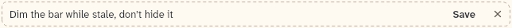
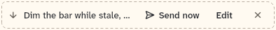

# QueuedRow

One queued message above the composer, with Send now, Edit and Remove, and an inline edit field.

```dart
import 'package:agent_kit/agent_kit.dart';
```

## Demo

<picture>
  <source media="(prefers-color-scheme: dark)" srcset="shots/queued_row_wide-dark.png">
  
</picture>

*Wide, 640 px: a queued message with the Queued label, the text, and the Send now, Edit and remove buttons.*

<picture>
  <source media="(prefers-color-scheme: dark)" srcset="shots/queued_row_editing-dark.png">
  
</picture>

*Editing: Edit turned the row into an inline field with Save and Cancel edit.*

<picture>
  <source media="(prefers-color-scheme: dark)" srcset="shots/queued_row_phone-dark.png">
  
</picture>

*Phone, 390 px: the Queued label is hidden at compact width. The text and the buttons remain.*

## Parameters

| Parameter | Type | Notes |
|---|---|---|
| `input` | `QueuedInput` | Required. The message. Its `id` goes back through the callbacks. |
| `onSendNow` | `ValueChanged<QueuedInput>?` | Send now. Delivers the message at once as a steer. |
| `onEdit` | `void Function(QueuedInput input, String text)?` | Called when an edit is saved with non-empty text that differs from the original. |
| `onRemove` | `ValueChanged<QueuedInput>?` | The remove (×) callback. |
| `initiallyEditing` | `bool` | Default `false`. Starts as the inline field. |
| `hideUnavailable` | `bool` | Default `false`. Leaves out an action whose callback is null instead of drawing it disabled. |

## Theme roles

`BbTheme` roles read in `queued_row.dart`:

- `ink`, `faint`, `radii.field`, `typeScale.ui`, `typeScale.body` (touch edit field)
- `colors.borderStrong` (the dashed outline), `colors.bgSelectedBlock` (Send now hover)

## Size classes

- The "Queued" label is shown only when `!size.isCompact` (below 600 px it is hidden) (`queued_row.dart:117`).
- Touch uses 40 px buttons and a 40 px minimum height; otherwise 24 px buttons and a 32 px minimum height.
- The text truncates with an ellipsis on one line; the buttons do not shrink.

## Accessibility

- The row has the semantics label `Queued message`.
- Send now has the key hint tooltip `Deliver now as a steer` (`KitTip`).
- The remove button's label is `Remove`.
- The edit field has the semantics label `Edit queued message` and a `Message` placeholder.
- Keys in the edit field: Enter saves; Esc cancels without reporting (`_editRow`).
- The cancel button's label is `Cancel edit`.

## Gallery and tests

- Gallery scene: the Components scene (`apps/gallery/lib/src/components_scene.dart`). Specimens: the QueuedRow frames (640 wide, long text, editing, phone) in `apps/gallery/lib/components/composer.dart`.
- Golden shots: `apps/gallery/test/component_shots_test.dart` writes `queued_row_wide`, `_editing` and `_phone` to `apps/gallery/test/goldens/shots/`. `scenes_golden_test.dart` covers the sheet as `components_1000_light.png` and `components_1000_dark.png`.
- `packages/agent_kit/test/composer/queued_row_test.dart`: the label at 640 and its hiding at 390, long text, Send now and remove callbacks, Edit and Save, Enter saves, and Esc cancels.
- `packages/agent_kit/test/composer/composer_golden_test.dart`: the composer goldens include the row.
- `packages/agent_kit/test/compositions/agent_chat_pane_test.dart` mentions the row.
