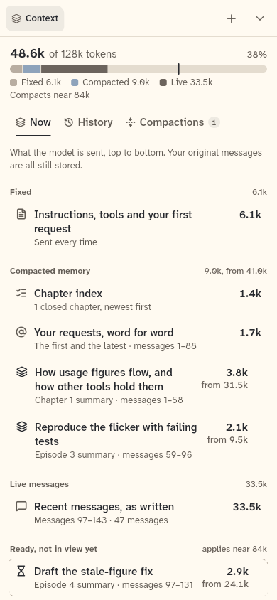

# AgentContextPane

The Context pane of one chat, which loads the chat's context structure from the backend and shows it with `ContextPane` as the Context tab of the workspace that `AgentWorkbench` opens.

```dart
import 'package:agent_kit/agent_kit.dart';
```

## Demo

<picture>
  <source media="(prefers-color-scheme: dark)" srcset="shots/agent_context_pane_390-dark.png">
  
</picture>

*Phone (scene F at 390 px): the Context pane as the Context tab of the full-screen workspace sheet, which covers the chat. The shot shows the meter (48.6k of 128k tokens, 38%), the Now, History and Compactions tabs, and the Now rows: fixed, compacted memory and live messages. The gallery builds it through `AgentWorkbench` with the Context workspace controller.*

## Parameters

| Parameter | Type | Notes |
|---|---|---|
| `backend` | `AgentBackend` | required. Supplies `loadContext`, `loadHistoryRange` and `loadSummary`. Without the `context` capability the pane shows a quiet line instead. |
| `chatId` | `String` | required. The chat whose context is loaded. A change of chat or backend reloads the structure. |
| `view` | `ContextView?` | required, and may be null. The serving view (`ChatSnapshot.context`). Each change reloads the structure. Null shows "This chat has no context data yet." |
| `controller` | `ContextPaneController?` | Passed to `ContextPane`. `AgentWorkbench` calls its `showNow()` when the header meter or the compaction marker opens the pane. |
| `now` | `DateTime?` | Replaces the wall clock for ages. Passed to `ContextPane`. |
| `renderer` | `MarkdownRenderer` | Default `LeanMarkdownRenderer()`. Passed to `ContextPane`. |

## Theme roles

`BbTheme` roles read in `agent_context_pane.dart`:

- `surface`: the background of the quiet line (`:88`).
- `faint` and `typeScale.ui`: the text of the quiet line (`:95`).

## Size classes

The pane does not read `SizeClass`. It fills the area it is given. The `ContextPane` it builds lays out by its own width: from `KitLayout.contextSplit` (680 px) the summary detail sits beside the list (`context/context_pane.dart:319`; `context/README.md:25`). The 680 px value comes from bb-ui's `KitLayout`.

## Accessibility

None in the code. This file has no `Semantics`, labels or key handling. The `ContextPane` it builds reads `BbTheme.reducedMotion` (`context/context_pane.dart:193`).

## Gallery and tests

- Gallery scene: F (Context) at 1600 px and 390 px. `buildScene` in `apps/gallery/lib/src/scenes.dart:127-151` builds the workbench with `controller.contextWorkspaceController` as its workspace (`:136-139`). `AgentWorkbench._paneBuilder` (`packages/agent_kit/lib/src/compositions/agent_workbench.dart:305`) builds this pane for the Context tab.
- Golden: the shot is a copy of `apps/gallery/test/goldens/f_context_390_light.png` (and `_dark.png`). `apps/gallery/test/scenes_golden_test.dart` writes it (scene context at 390 × 844), not `component_shots_test.dart`. The copies are byte-identical to the scene goldens.
- Other tests:
  - No test mounts `AgentContextPane` directly. Grep for `AgentContextPane` under `packages/agent_kit/test/` finds nothing.
  - `packages/agent_kit/test/context/context_marker_test.dart` (group `AgentWorkbench`): the compaction marker's View and the header meter open the Context pane through the workbench.
  - `packages/agent_kit/test/context/context_pane_test.dart` tests `ContextPane`, the widget this pane builds.
- No package golden covers this pane.
