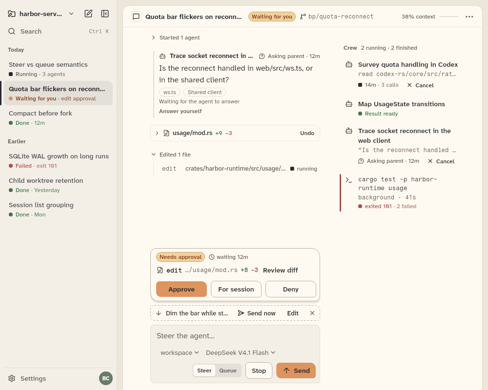

# AgentWorkbench

The whole agent app on one `AgentBackend`: the session rail, the chat pane, the crew ledger or strip, and an optional workspace beside the chat (`AgentChatPane` and `AgentContextPane` have their own sheets).

```dart
import 'package:agent_kit/agent_kit.dart';
```

## Demo

<picture>
  <source media="(prefers-color-scheme: dark)" srcset="shots/agent_workbench_1000-dark.png">
  
</picture>

*Expanded, no workspace (scene A at 1000 px): the rail, the chat sheet, and the "Crew" ledger beside the transcript with its running and finished agents. The workspace is closed. The scene uses the gallery's scripted chat, played to its end on a manual clock.*

## Parameters

| Parameter | Type | Notes |
|---|---|---|
| `backend` | `AgentBackend` | required. Where the chats live. |
| `initialChatId` | `String?` | The chat to open first. The newest chat when null. |
| `workspaceName` | `String` | Default `''`. The project switcher's label in the rail. |
| `initials` | `String` | Default `''`. The avatar's letters. |
| `now` | `DateTime?` | Replaces the wall clock for ages (tests, the gallery). |
| `modelUsage` | `List<ModelUsage>` | Default `[]`. Tokens per model for the ledger's "By model" bars. The host supplies them; the kit cannot read them from a backend. |
| `detailFor` | `String? Function(ChatSummary)?` | The text after a rail row's status label. The workbench uses its own default when this returns null. |
| `railController` | `RailController?` | Shows and hides the rail from outside. The workbench makes one when null. |
| `workspaceController` | `WorkspaceController?` | The workspace's layout. The workspace exists only when this and `workspacePaneBuilder` are both given. |
| `workspaceKinds` | `List<WorkspaceKind>` | Default `[]`. The kinds the workspace's + menu lists. |
| `workspacePaneBuilder` | `WorkspacePaneBuilder?` | What each workspace pane shows. |
| `initialWorkspaceShown` | `bool` | Default `false`. Whether the workspace starts open. |
| `onNewChat` | `VoidCallback?` | The rail's new-chat button. When null, the workbench calls `backend.createChat()` and opens the new chat. |
| `onSearch` | `VoidCallback?` | Passed to the rail's search row. |
| `onSwitchWorkspace` | `VoidCallback?` | Passed to the rail's project switcher. |
| `onSettings` | `VoidCallback?` | Passed to the rail's Settings button. |
| `transcriptActions` | `TranscriptActions` | Default `TranscriptActions()`. What the transcript's rows open. |
| `mentions` | `MentionSource?` | Where `@` mentions in the composer come from. |
| `onReviewApproval` | `ValueChanged<Approval>?` | "Review diff" on an approval. |
| `onOpenAgent` | `ValueChanged<ChildAgent>?` | A crew chip was opened. |
| `onOpenJob` | `ValueChanged<BackgroundJob>?` | A background job in the crew was opened. |

## Theme roles

`BbTheme` roles read in `agent_workbench.dart`:

- `canvas`: the desk behind the sheets (`agent_workbench.dart:366`).
- `surface`: the sheet and the compact sheet (`:497`, `:507`).
- `radii.sheet`: the sheet's top corners (`:500`).
- `colors.stack`: the sheet's shadow. `colors` is bb-ui's `AppColors`.
- `typeScale.ui`, `faint`, `muted`: the "Loading…" and empty-state text (`:565`, `:574`).
- `dangerInk`: the ledger's cancel error (`:549`).

## Size classes

The workbench reads two classes, not the window width (the layout comment at `agent_workbench.dart:3-13`).

- The whole width gives the rail class (`RailScope`, from `RailLayout`). It picks the rail: a column, or a sliding screen when compact. It also picks the crew. The ledger shows beside the transcript when the whole width is expanded and no workspace is open (`ledger = whole.isExpanded && !shown`). Otherwise the crew shows as the strip under the header.
- The area beside the rail is measured by a `SizeClassBuilder` (`:391`). When the workspace is open:
  - expanded: the chat sheet is `min(584, max(444, 0.44 × width))` px and the workspace takes the rest;
  - medium: the workspace is a column on the right, `min(420, max(240, 0.4 × width))` px, and the chat takes the rest;
  - compact: the workspace is a full-screen layer over the chat sheet.
- Thresholds: compact below 600 px, medium below 1000 px, expanded from 1000 px. These are `BbTheme.sizeMedium` and `sizeExpanded` (see `BbTheme.md`).

## Accessibility

- The ledger's cancel error is a live region (`agent_workbench.dart:545`), shown under the ledger with the key `ledger-cancel-error`.
- Empty and failed list states: "Loading…" while the first list loads; "No chats yet" with a "New chat" button; a list error with a "Retry" button (`_empty`, `:562`).
- The rail's show and hide buttons are labelled in `chrome/`: "Sessions" in compact (`chrome/rail_layout.dart`), "Show sidebar" when the column is hidden, and "Hide sidebar" (`chrome/session_rail.dart:132`).
- The workbench adds no key bindings of its own. The approval keys 1, 2 and 3 come from the chat pane's approval bar (`AgentChatPane.md`).

## Gallery and tests

- Gallery scene: A (Workbench) at 1440 px and 1000 px. `buildScene` in `apps/gallery/lib/src/scenes.dart:127-151` builds the `AgentWorkbench`. The same widget builds scene C (Phone, 390 px) and scene F (Context). `apps/gallery/lib/src/live_gallery.dart:147` builds it for the live gallery.
- Golden: the shot is a copy of `apps/gallery/test/goldens/a_workbench_1000_light.png` (and `_dark.png`). `apps/gallery/test/scenes_golden_test.dart` writes these scene goldens (scene workbench at 1000 × 800), not `component_shots_test.dart`. The copies are byte-identical to the scene goldens.
- Other tests:
  - `packages/agent_kit/test/compositions/agent_workbench_test.dart`: the rail lists and opens chats, hides and shows, new chat, paged chats, Cancel on a running agent (and the refused case), the ledger or strip by width, the workspace toggle beside the chat, and the compact sheet.
  - `packages/agent_kit/test/context/context_marker_test.dart` (group `AgentWorkbench`): the compaction marker's View and the header meter open the Context pane through the workbench.
  - `packages/agent_kit/test/compositions/compositions_harness.dart`: the shared harness for the composition tests.
- No package golden covers the workbench.
