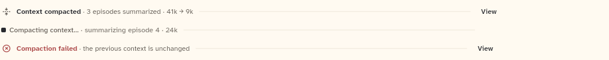

# CompactionMarker

One quiet line in the assistant turn where a compaction was applied, was running, or failed. It opens the Context pane through `onView`.

```dart
import 'package:agent_kit/agent_kit.dart';
```

## Demo

<picture>
  <source media="(prefers-color-scheme: dark)" srcset="shots/compaction_marker-dark.png">
  
</picture>

*Done: the context was compacted. The gallery passes `episodesSummarized: 3`, `tokensBefore: 41000`, `tokensAfter: 9000` and an `onView`, so the line reads "3 episodes summarized · 41k → 9k" and shows View.*

*Running: compaction in progress. The gallery passes `state: running` and `detail: 'summarizing episode 4 · 24k'`. No lead glyph and no View button; the line is a `StatusMark` with the running status.*

*Failed: compaction failed. The gallery passes `state: failed` and `detail: 'the previous context is unchanged'`. Red X glyph, red title, and View (the gallery passes `onView`).*

## Parameters

| Parameter | Type | Notes |
|---|---|---|
| `item` | `CompactionItem` (required, positional) | The state, `episodesSummarized`, `tokensBefore`, `tokensAfter` and `detail` of the event. |
| `onView` | `VoidCallback?` | Opens the Context pane on Now. Without it the View button is left out. The button is also hidden while the state is running. |

## Theme roles

`ink` (done title), `muted` (detail text), `typeScale.uiSmall`, `colors.iconSecondary` (done glyph), `colors.borderSubtle` (hairline), `statusStyle(ChatStatus.failed).ink` (failed glyph and title).

## Size classes

The widget reads `sizeClassOf(context).isCompact`:

- Compact: "N episodes summarized" is left out, the hairline is replaced by a spacer, and the line may wrap to two lines. The sizes text (`41k → 9k`) stays.
- Otherwise: one line, with the hairline between the text and the View button.

`sizeClassOf` returns the nearest `SizeClassBuilder`'s class, or expanded when there is none (`transcript_support.dart`).

## Accessibility

- The whole line is one `Semantics` node labelled with the title and the parts joined by commas. Its children are excluded.
- A running line is a live region (`liveRegion: running`).
- The View button is a `KitTextButton` with the label "View".
- No reduced-motion handling in the code.

## Gallery and tests

- Gallery scene: Components (`GalleryScene.components`). Specimen: `ContextSpecimens` in `apps/gallery/lib/components/context.dart`, the "Compaction marker: done, running, failed" entries.
- Golden: `apps/gallery/test/component_shots_test.dart` writes `compaction_marker_light.png` and `_dark.png` (shot indices 0 to 2). The whole sheet is in `apps/gallery/test/goldens/components_1000_<theme>.png`.
- Other tests:
  - `packages/agent_kit/test/context/context_marker_test.dart`: "done: title, figures and View", "running: no View, shows the detail", "failed: says so and that nothing changed", "the marker's View opens the Context pane".
  - `packages/agent_kit/test/context/context_golden_test.dart` (tag `golden`): `packages/agent_kit/test/goldens/context_marker_390_<theme>.png` and `context_marker_1000_<theme>.png`.
