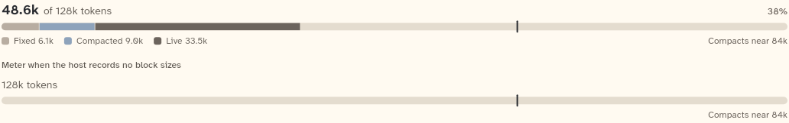

# ContextMeterBar

The context meter of the Context pane: the token count against the window, a stacked bar of the context's parts, and a legend. The header's `ContextMeter` is a different widget.

```dart
import 'package:agent_kit/agent_kit.dart';
```

## Demo

<picture>
  <source media="(prefers-color-scheme: dark)" srcset="shots/context_meter_bar-dark.png">
  
</picture>

*Segments: a view with block sizes. The bar shows Fixed 6.1k, Compacted 9.0k and Live 33.5k of 128k, 38%, a tick at the compaction cap near 84k, the legend and "Compacts near 84k".*

*No block sizes: a view with a window and no block sizes. The bar shows the window only: "128k tokens", no count, no percentage, no legend. The cap tick and "Compacts near 84k" stay.*

## Parameters

| Parameter | Type | Notes |
|---|---|---|
| `view` | `ContextView` (required) | The serving view. Read: `totalTokens`, `window`, `applyCap`, `openingTokens`, `memoryTokens`, `liveTokens`. |

## Theme roles

`ctxOpening`, `ctxSummary`, `ctxLive` (the three segment colours), `seam` (bar track), `ink` (token count, cap tick), `muted` (headline, legend), `faint` (percentage, cap label), `typeScale.ui`, `typeScale.uiSmall`.

## Size classes

Does not read the size class. It reads its own width:

- The bar is scaled to the window (or to the cap when there is no window).
- Below 440 px of width the cap label wraps under the legend. At 440 px or more it sits at the right of the legend.
- The headline ellipsises on one line when it does not fit.

## Accessibility

- The bar has a `Semantics` node (`container`, `image`) whose label is the full text: the count, the window, each segment with its size, and the cap. Its children are excluded.
- Each legend item is text, so colour does not carry the segments alone.
- The cap label has the key `context-cap-label` (for tests). It is a separate text node.
- No reduced-motion handling in the code.

## Gallery and tests

- Gallery scene: Components (`GalleryScene.components`). Specimen: `ContextSpecimens` in `apps/gallery/lib/components/context.dart`, the "Context meter with segments and the apply cap" and "Meter when the host records no block sizes" entries.
- Golden: `apps/gallery/test/component_shots_test.dart` writes `context_meter_bar_light.png` and `_dark.png` (shot indices 0 and 1). The whole sheet is in `apps/gallery/test/goldens/components_1000_<theme>.png`.
- Other tests:
  - `packages/agent_kit/test/context/context_golden_test.dart` (tag `golden`): the pane goldens that contain the bar.
  - `packages/agent_kit/test/context/context_pane_test.dart`: "a view without block sizes shows no token figures", "a missing window, sizes and write time render as absent".
