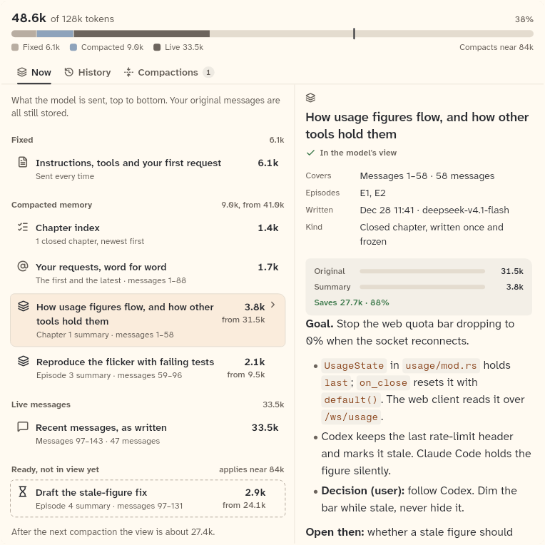
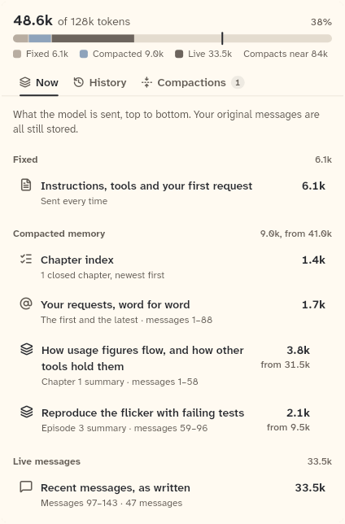
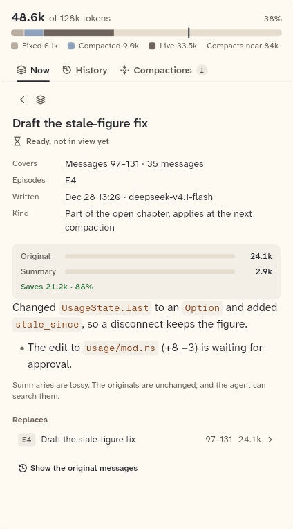
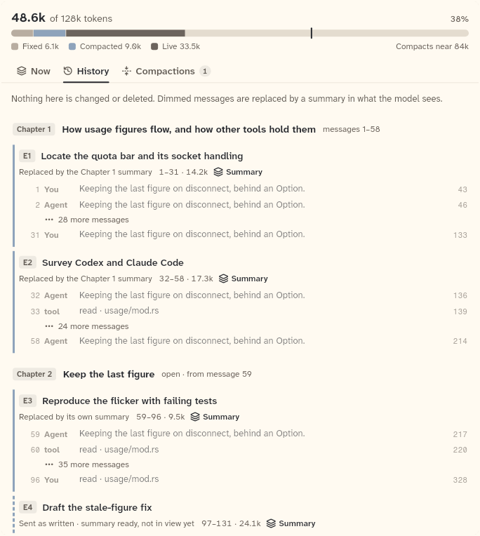
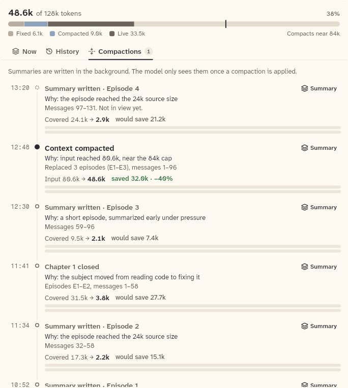

# ContextPane

The Context pane: what the model sees now, the original history and the compactions over time, under the context meter. It is fed by the host and does not load data itself. `ContextPaneController`, `ContextTab` and `SummaryLoader` sit on the same sheet.

```dart
import 'package:agent_kit/agent_kit.dart';
```

## Demo

<picture>
  <source media="(prefers-color-scheme: dark)" srcset="shots/context_pane_wide-dark.png">
  
</picture>

*Wide, 760 px: the Now list and the detail side by side. The detail shows the Chapter 1 summary. The gallery passes `initialSummaryId: 'sum-ch1'`.*

<picture>
  <source media="(prefers-color-scheme: dark)" srcset="shots/context_pane_narrow-dark.png">
  
</picture>

*Narrow, 420 px: the Now list only. No summary is open.*

<picture>
  <source media="(prefers-color-scheme: dark)" srcset="shots/context_pane_summary-dark.png">
  
</picture>

*Narrow with a summary open, 420 px: the detail replaces the list, with a back button. The gallery passes `initialSummaryId: 'sum-e4'` (the stale-figure draft, not yet in view).*

<picture>
  <source media="(prefers-color-scheme: dark)" srcset="shots/context_pane_history-dark.png">
  
</picture>

*History tab, 680 px: the original messages with chapters and episodes over them. The gallery passes `initialTab: ContextTab.history`.*

<picture>
  <source media="(prefers-color-scheme: dark)" srcset="shots/context_pane_compactions-dark.png">
  
</picture>

*Compactions tab, 680 px: the timeline of summaries and applied compactions. The gallery passes `initialTab: ContextTab.compactions`.*

## Parameters

| Parameter | Type | Notes |
|---|---|---|
| `view` | `ContextView` (required) | The serving view (`ChatSnapshot.context`). Drives the meter and the Now list. |
| `details` | `ContextDetails?` | The structure behind the view. Null until the host has loaded it: the History and Compactions tabs then show "Loading…". The Now tab still builds without it. |
| `loadHistory` | `HistoryLoader?` | Loads original messages by range for the History tab. |
| `loadSummary` | `SummaryLoader?` | `Future<ContextSummary> Function(String summaryId)`. Loads one summary's full text for the detail. Called when the selected summary has no text yet. |
| `controller` | `ContextPaneController?` | Lets the host ask the pane to show Now, optionally on one summary. |
| `renderer` | `MarkdownRenderer` | Renders summary text. Default `LeanMarkdownRenderer()`. |
| `now` | `DateTime?` | Replaces the wall clock for the detail's times. Default `DateTime.now()`. |
| `initialTab` | `ContextTab` | The tab shown first. Default `ContextTab.now`. |
| `initialSummaryId` | `String?` | The summary the detail starts on. The detail opens when it is set. |

`ContextPaneController.showNow({String? summaryId})` brings Now forward and changes `token`. `ContextTab` has `now`, `history` and `compactions`.

## Theme roles

`surface` (pane background), `ink`, `muted`, `faint`, `hover`, `pressed`, `focus` (tab buttons), `radii.ctl`, `radii.pill` (tab buttons, count badge), `colors.borderSubtle` (header rule and the detail's left rule), `colors.iconSecondary` (tab glyphs), `typeScale.ui`, `motion.standard` and `motion.ease` (scroll to a row, see Accessibility), `layout.contextSplit` (the wide breakpoint).

## Size classes

The pane does not use `SizeClass`. It reads its own width from a `LayoutBuilder`:

- Wide: width at or above `layout.contextSplit`. The Now tab shows the list and the detail side by side. The detail is `(width × 0.46)` clamped to 300 to 440 px. With no `initialSummaryId`, the Now tab selects the default summary.
- Narrow: below `layout.contextSplit`. The list is shown; a summary replaces it behind a back button when one is selected.

The value of `layout.contextSplit` comes from `KitLayout` in `bb_ui`. The number is not in this repository.

## Accessibility

- Each tab is a button node with `selected`, in a mutually exclusive group. Its label is the tab name and, when there are any, the count of applied compactions (for example "Compactions, 1").
- Arrow Left and Right, Home and End move between tabs; Enter and Space select.
- Each tab panel has a `Semantics` label: "What the model sees now", "Original history", "Compactions over time".
- Escape clears the open detail when the Now tab is shown (`_onKey`). The back button, which returns to the list, appears only in the narrow layout.
- Scrolling to a selected row uses `motion.standard` and `motion.ease`, and a zero duration when `BbTheme.reducedMotion(context)` is true.

## Gallery and tests

- Gallery scene: Components (`GalleryScene.components`). Specimen: `ContextSpecimens` in `apps/gallery/lib/components/context.dart`, the "Context pane" entries (wide, narrow, narrow with summary open, History, Compactions).
- Golden: `apps/gallery/test/component_shots_test.dart` writes `context_pane_wide`, `context_pane_narrow`, `context_pane_summary`, `context_pane_history` and `context_pane_compactions` (`_light.png` and `_dark.png`, shot indices 0 to 4). The whole sheet is in `apps/gallery/test/goldens/components_1000_<theme>.png`.
- Other tests:
  - `packages/agent_kit/test/context/context_pane_test.dart`: arrow keys, Home and End; wide and narrow layouts; Back and Esc; timeline and history reverse navigation; the controller; missing data cases; "without details the pane still builds".
  - `packages/agent_kit/test/context/context_golden_test.dart` (tag `golden`): `packages/agent_kit/test/goldens/context_now_{390,420,680}_<theme>.png`, `context_summary_390_<theme>.png`, `context_history_{420,680}_<theme>.png`, `context_compactions_{420,680}_<theme>.png`.
  - `packages/agent_kit/test/context/context_marker_test.dart`: "the marker's View opens the Context pane" and "the header meter opens the Context pane".

## Related types

`ContextPaneController`, `ContextTab` and `SummaryLoader` are in `context_pane.dart`. `HistoryLoader` is re-exported from `context_history.dart`.

The parts `ContextNow`, `ContextDetail`, `ContextHistory` and `ContextTimeline` are in `context_now.dart`, `context_history.dart` and `context_timeline.dart`. The barrel `context.dart` does not export them, so they have no sheets here. Use `ContextPane`.
