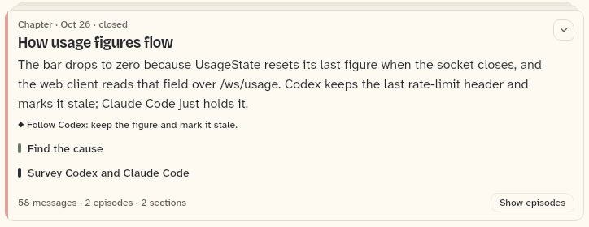
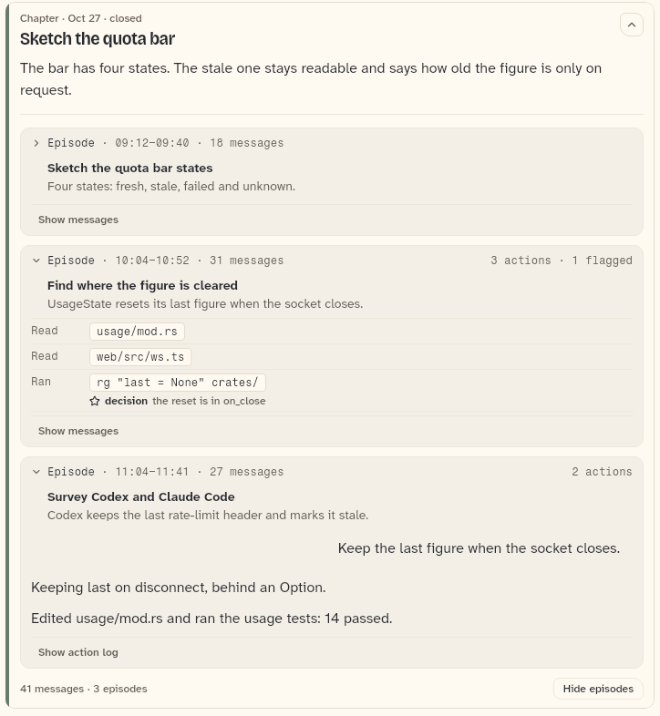
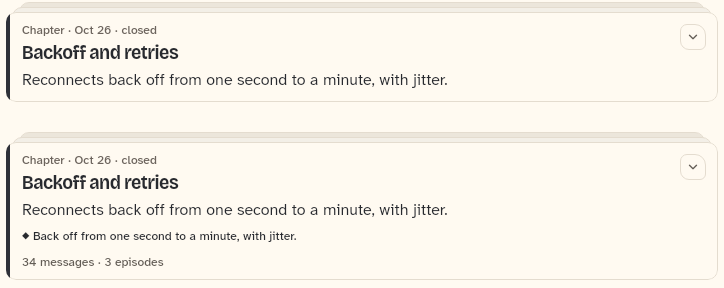

# HistoryChapterCard

A closed chapter of compacted history: a card whose face is the chapter summary, which opens to its episode cards. A split chapter is one card per part. The open chapter is `HistoryCurrentChapter`, the older summary is `HistoryLegacyCard`; both are on their own sheets.

```dart
import 'package:agent_kit/agent_kit.dart';
```

## Demo

<picture>
  <source media="(prefers-color-scheme: dark)" srcset="shots/history_chapter_card_closed-dark.png">
  
</picture>

*Closed: the card folded. The gallery builds chapter "How usage figures flow" (`c1`) with no `setChapterOpen`. The face shows the summary, a `◆` decision line and two section rows. The footer shows "58 messages · 2 episodes · 2 sections" and "Show episodes".*

<picture>
  <source media="(prefers-color-scheme: dark)" srcset="shots/history_chapter_card_open-dark.png">
  
</picture>

*Open: the card lists its episodes. The gallery opens chapter "Sketch the quota bar" (`c2`) with `setChapterOpen('c2', true)`. The episodes are in the states set by the scene: one closed, one with its action log, one with its messages. The footer reads "Hide episodes".*

<picture>
  <source media="(prefers-color-scheme: dark)" srcset="shots/history_chapter_card_split-dark.png">
  
</picture>

*Split: part 1 and part 2 of "Backoff and retries". Both are closed cards with the same title. Part 1 shows no decision line, no section rows, no counts and no episode toggle. Part 2, the last part, shows the decision line and "34 messages · 3 episodes". The model sets the totals and the decisions and sections only on the last part.*

## Parameters

| Parameter | Type | Notes |
|---|---|---|
| `chapter` | `HistoryChapter` (required) | The chapter or one part of a split chapter. Read: `title`, `summary`, `startedAt`, `closed`, `messageCount`, `episodeCount`, `episodes`, `decisions`, `sections`, `colorIndex`. |
| `controller` | `HistoryController` (required) | Holds the fold state: whether the card is open (`chapterOpen`, `toggleChapter`) and each episode's view. |
| `messagesBuilder` | `HistoryMessagesBuilder?` | Builds an episode's original messages. Without it, episodes that have no actions have no "Show messages" button, and a messages view is not built. |

## Theme roles

The fold frame is `FoldableStackCard` (bb_ui). Roles read in the file: `colors.borderSubtle` (rule above the episodes), `colors.textPrimary` (summary and decision text), `colors.textSecondary` (footer counts), `ink` (decision marker), `typeScale.body` (summary), `typeScale.uiSmall` (decision, counts, footer).

The edge colour comes from `outlineColor(context, chapter.colorIndex)` (the outline folder). Each section row takes `outlineColor(context, colorIndex + 1 + i)`.

## Size classes

Does not read the size class. The width is the parent's; the card takes whatever width its list gives it, with a 4 px horizontal inset.

## Accessibility

- The card's label is built from "Chapter", the start time when known, and "closed" when `closed` is true. It is passed to `FoldableStackCard` as its label.
- The `◆` marker on each decision is excluded from semantics (`ExcludeSemantics`), so the text is read alone.
- The footer's toggle is a `FooterAction` labelled "Show episodes" or "Hide episodes". It is not shown when the chapter has no episodes.
- Keys for tests: `history-chapter-<key>-face`, `history-chapter-<key>-decision-<i>`, `history-chapter-<key>-section-<i>`, `history-chapter-<key>-toggle`.
- No reduced-motion handling in this file.

## Gallery and tests

- Gallery scene: History (`GalleryScene.history`, `apps/gallery/lib/src/history_scene.dart`, `HistoryScene`). The chapter list is `_chapters`; the scene opens `c2` and leaves `c1` folded.
- Golden: `apps/gallery/test/component_shots_test.dart` writes `history_chapter_card_closed` (index 0), `history_chapter_card_open` (index 1) and `history_chapter_card_split` (indices 2 and 3), each `_light.png` and `_dark.png`. The whole scene is in `apps/gallery/test/scenes_golden_test.dart` as `h_history_1600_<theme>.png` and `h_history_390_<theme>.png`.
- Other tests, `packages/agent_kit/test/history/history_test.dart`:
  - "reads alone, opens into episodes and folds again"
  - "only the last part of a split chapter shows counts"
  - "decisions and sections are rows of the face; empty ones leave their rows out"
  - "a chapter without a summary shows the title only"
