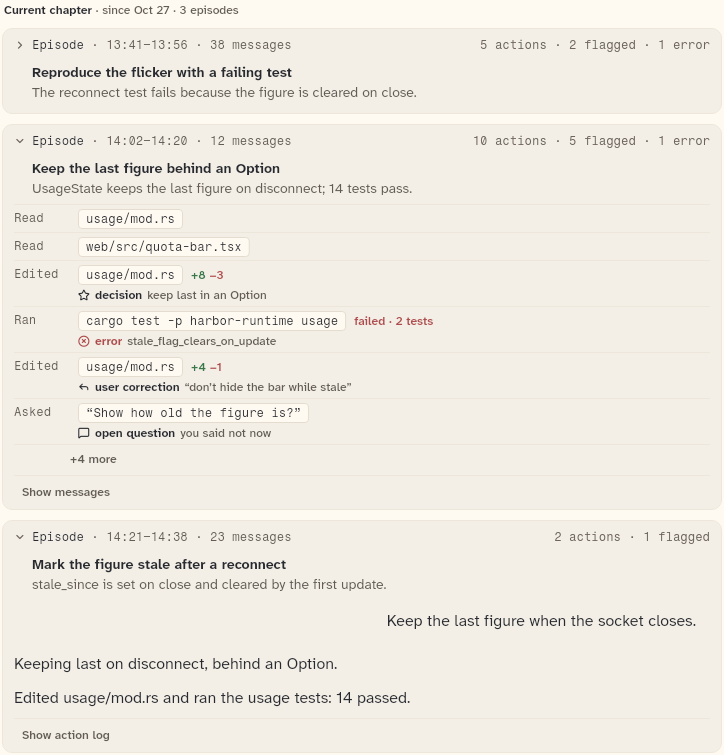

# HistoryCurrentChapter

The open chapter of compacted history: a plain group header over its episode cards. It has no title or summary yet; those are written when the chapter closes, so the card is `HistoryChapterCard` only after that.

```dart
import 'package:agent_kit/agent_kit.dart';
```

## Demo

<picture>
  <source media="(prefers-color-scheme: dark)" srcset="shots/history_current_chapter-dark.png">
  
</picture>

*Open chapter: "Current chapter · since Oct 27 · 3 episodes" over three episode cards. The gallery builds an open `HistoryChapter` whose episodes are in three states: one closed, one with its action log open, one with its messages open. The episodes are always listed; there is no fold.*

## Parameters

| Parameter | Type | Notes |
|---|---|---|
| `chapter` | `HistoryChapter` (required) | The open chapter. Read: `startedAt`, `episodes`, `key`. The header's start time comes from `historyWhen(startedAt, null)`, so it reads "since <date>". |
| `controller` | `HistoryController` (required) | Holds each episode card's view and "+N more" state. |
| `messagesBuilder` | `HistoryMessagesBuilder?` | Builds an episode's original messages, as for `HistoryEpisodeCard`. |

## Theme roles

`muted` (header text), `ink` (the bold "Current chapter"), `faint` (the separators), `typeScale.uiSmall`.

## Size classes

Does not read the size class. The header and episode list take the width of their parent.

## Accessibility

- No `Semantics` node of its own. The header is one `Text.rich`, keyed `history-current-<key>` for tests, and its text is read as written.
- The episode cards carry their own accessibility (see `HistoryEpisodeCard`).
- No reduced-motion handling in this file.

## Gallery and tests

- Gallery scene: History (`GalleryScene.history`, `HistoryScene` in `apps/gallery/lib/src/history_scene.dart`). The open chapter is built with `HistoryCurrentChapter` in the scene's chapter loop.
- Golden: `apps/gallery/test/component_shots_test.dart` writes `history_current_chapter` (index 0), `_light.png` and `_dark.png`. The whole scene is in `apps/gallery/test/goldens/h_history_1600_<theme>.png` and `h_history_390_<theme>.png`.
- Other tests, `packages/agent_kit/test/history/history_test.dart`: "the current chapter is a plain header over its episodes".
