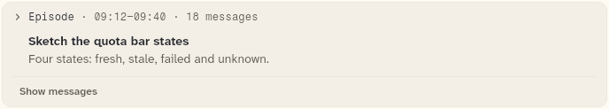
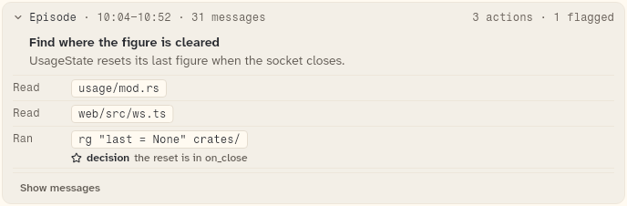
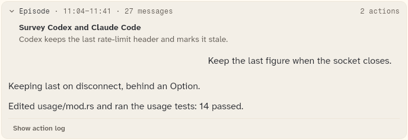

# HistoryEpisodeCard

One episode of compacted history: a header line, the title and a gist. It opens into its action log, or into the original messages. Used inside `HistoryChapterCard` and `HistoryCurrentChapter`.

```dart
import 'package:agent_kit/agent_kit.dart';
```

## Demo

<picture>
  <source media="(prefers-color-scheme: dark)" srcset="shots/history_episode_card_unlogged-dark.png">
  
</picture>

*Unlogged: an episode with no actions, closed. The gallery builds episode `v2`, "Sketch the quota bar states", with no actions. The footer is "Show messages"; the header has no counts because there are no actions.*

<picture>
  <source media="(prefers-color-scheme: dark)" srcset="shots/history_episode_card_log-dark.png">
  
</picture>

*Log: the action log is open. The gallery sets `setEpisodeView('e1', log)` on "Find where the figure is cleared". The header shows "3 actions · 1 flagged", the rows are Read, Read and Ran with a decision marker, and the footer is "Show messages".*

<picture>
  <source media="(prefers-color-scheme: dark)" srcset="shots/history_episode_card_messages-dark.png">
  
</picture>

*Messages: the original messages are open. The gallery sets `setEpisodeView('e2', messages)` on "Survey Codex and Claude Code" and passes `messagesBuilder`, which builds three message rows (one user message, two assistant messages). The footer is "Show action log".*

## Parameters

| Parameter | Type | Notes |
|---|---|---|
| `episode` | `HistoryEpisode` (required) | Read: `id`, `title`, `gist`, `startedAt`, `endedAt`, `messageCount`, `actions`, `actionCount`, `flaggedCount`, `errorCount`, `hasActions`. |
| `controller` | `HistoryController` (required) | Holds the episode's view (`episodeView`, `setEpisodeView`) and whether all action rows are shown (`moreShown`, `showMore`). |
| `messagesBuilder` | `HistoryMessagesBuilder?` | Builds the original messages. Without it there is no "Show messages" button and the messages view is never built. |

## Behaviour

Views are `HistoryEpisodeView.closed`, `log` and `messages`.

- Header tap (the whole header row): from closed it opens the log when `hasActions`, otherwise the messages. From an open view it closes.
- Footer:
  - in the log view, "Show messages" (when `messagesBuilder` is set);
  - in the messages view, "Show action log" (when the episode has actions);
  - with no actions and closed, "Show messages" (when `messagesBuilder` is set).
- The header counts are "N actions", then "M flagged" when `flaggedCount > 0`, then "K error(s)" when `errorCount > 0`. They are left out when the episode has no actions or when the width is compact.
- The action log shows the first six rows (a private constant, `historyActionsShown`). Past six, a "+N more" button (`controller.showMore`) shows the rest. Exactly six rows show no button.
- Action rows: a verb, the target in a chip, and for a point of interest a line with its kind word: `decision`, `user correction`, `error` or `open question`, with its own glyph. The error line is coloured `dangerInk`.

## Theme roles

`surface2` (card background), `colors.borderSubtle` (card border, footer rule, log rule), `faint` and `muted` (header and gist), `ink` (title, kind words), `typeScale.ui` (title, gist), `typeScale.uiSmall` (header, counts, footer), `radii.lg` (`Radii.lg`, card corners), `constructiveInk` and `dangerInk` (action tones), `seam` and `surface` (action rows, from `_ActionRow`), `radii.sm` (action chips).

## Size classes

The card reads `sizeClassOf(context).isCompact`:

- Compact: card padding 10 instead of 12, the header counts are left out, and the action rows are at most 220 px wide (520 px otherwise).
- Header minimum height: 40 px on touch (`isTouch`), 34 px otherwise.

## Accessibility

- The card is a `Semantics` container labelled "Episode, <clock>", where the clock comes from `historyClock`.
- The header is a `Hover` with `onTap`; its key is `history-episode-<id>-header`. The disclosure chevron is a `DisclosureChevron`.
- Each point's glyph is excluded from semantics (`ExcludeSemantics`); the kind word is read.
- Keys for tests: `history-episode-<id>-messages`, `history-episode-<id>-log`, `history-episode-<id>-more`, `history-episode-<id>-log-rows`.
- No reduced-motion handling in this file.

## Gallery and tests

- Gallery scene: History (`GalleryScene.history`, `HistoryScene`). Episodes `e1` (log), `e2` (messages), `e4` (log) and `e5` (messages) are set open in the scene's controller; `v2` has no actions.
- Golden: `apps/gallery/test/component_shots_test.dart` writes `history_episode_card_unlogged` (index 0), `history_episode_card_log` (index 1) and `history_episode_card_messages` (index 2), each `_light.png` and `_dark.png`. The whole scene is in `h_history_1600_<theme>.png` and `h_history_390_<theme>.png`.
- Other tests, `packages/agent_kit/test/history/history_test.dart`:
  - "header, log, messages and back"
  - "rows past six fold behind \"+N more\""
  - "exactly six rows fold nothing"
  - "an episode without actions has no counts and goes to messages"
  - "points of interest show their kind and reason"
