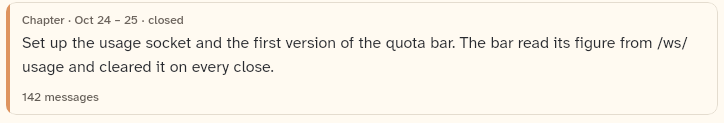

# HistoryLegacyCard

A summary from before chapters and episodes: the title (when there is one), the summary, the start and end times and the message count. Nothing opens in it.

```dart
import 'package:agent_kit/agent_kit.dart';
```

## Demo

<picture>
  <source media="(prefers-color-scheme: dark)" srcset="shots/history_legacy_card-dark.png">
  
</picture>

*Legacy: the card of the checkpoint summary from before chapters. The gallery builds `HistoryLegacy` `checkpoint` with no title, so the card shows "Chapter · Oct 24 – 25 · closed", the summary and "142 messages". The orange left edge is `outlineColor(context, colorIndex)`.*

## Parameters

| Parameter | Type | Notes |
|---|---|---|
| `legacy` | `HistoryLegacy` (required) | Read: `title` (shown only when non-null and non-empty), `summary`, `startedAt`, `endedAt`, `messageCount`, `colorIndex`. |

## Theme roles

`colors.bgElevated` (card background), `colors.border` (card border), `colors.textTertiary` (header line), `colors.textPrimary` (title and summary), `colors.textSecondary` (message count), `typeScale.uiSmall`, `typeScale.body`, `typeScale.h3` (title, through `tsDisplay`), `Radii.lg` (corners). The edge colour comes from `outlineColor(context, colorIndex)`.

## Size classes

Does not read the size class. The card takes the width of its parent.

## Accessibility

- No `Semantics` node and no tooltip. The text is read as written.
- No interaction. Nothing opens in the card.
- No reduced-motion handling in this file.

## Gallery and tests

- Gallery scene: History (`GalleryScene.history`, `HistoryScene`). The legacy entry is the first item of the scene's chapter list.
- Golden: `apps/gallery/test/component_shots_test.dart` writes `history_legacy_card` (index 0), `_light.png` and `_dark.png`. The whole scene is in `h_history_1600_<theme>.png` and `h_history_390_<theme>.png`.
- Other tests, `packages/agent_kit/test/history/history_test.dart`: "a legacy card shows title, summary, times and count".
