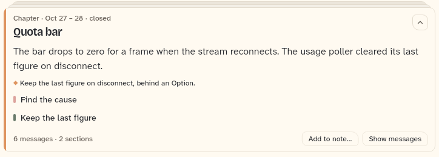
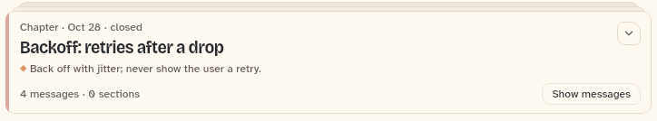

# OutlineChapterCard

A closed chapter in the outline: a folding card with the chapter's title, one line on its face (the decision, or a gist), and a footer with the counts and the message toggle. Opening it shows the summary, the decision and the section rows. Also documented here: `OutlineAction`, the host's menu and button entry, and `outlineColor`, the chapter colour.

```dart
import 'package:agent_kit/agent_kit.dart';
```

## Demo

<picture>
  <source media="(prefers-color-scheme: dark)" srcset="shots/outline_chapter_card_sections-dark.png">
  
</picture>

*Open, with sections: "Quota bar", open. It shows the summary, the decision line, the section rows "Find the cause" and "Keep the last figure", the count "6 messages · 2 sections", and the footer buttons "Add to note…" (a host action, shown only while open) and "Show messages". The gallery sets `fold.expanded['m0'] = true` and passes `cardActions` with one action.*

<picture>
  <source media="(prefers-color-scheme: dark)" srcset="shots/outline_chapter_card_plain-dark.png">
  
</picture>

*Closed, plain: "Backoff: retries after a drop", closed. The face is its decision line. It has no sections, so no section rows show. The footer reads "4 messages · 0 sections" and "Show messages". No host actions show, because the card is not open.*

## Parameters

| Parameter | Type | Notes |
|---|---|---|
| `chapter` | `OutlineChapter` (required) | The chapter. Read: `title`, `summary`, `decision`, `gist`, `sections`, `messageCount`, `when`, `id`. |
| `color` | `Color` (required) | The edge colour of the card. The host gives it, usually from `outlineColor(context, index)`. |
| `messagesShown` | `bool` (required) | Whether the chapter's messages show below the card. Sets the toggle label. |
| `onToggleMessages` | `VoidCallback` (required) | Called by "Show messages" or "Hide messages". `OutlineList` calls `controller.toggleMessages`. |
| `onOpenSection` | `ValueChanged<OutlineSection>` (required) | Called when a section row is tapped. |
| `actions` | `List<OutlineAction>` | Default `[]`. Buttons in the footer, shown only while the card is open. |
| `open` | `bool?` | Whether the card is open. Null leaves the fold to the card. |
| `onOpenChanged` | `ValueChanged<bool>?` | Called when the card opens or closes. |

`OutlineAction` has `label` (required), `onSelected` (required) and `icon` (`Ico?`). The kit shows the label and calls `onSelected`.

## Behaviour

- Label: "Chapter · <when> · closed", where `when` is the date range from the chapter's start and end.
- Face: the chapter's decision (`DecisionLine`, with `peek: true`) when it has one; otherwise the gist as one line of text, with the key `outline-card-gist-<id>`; otherwise nothing.
- Body: the summary when it is not empty, the decision line, and a section row per section (`outline-card-section-<section id>`), each tapping `onOpenSection`.
- Footer: the count line (`outlineCountLine`: "N messages · M sections"); then, when open, each host action (`outline-card-action-<id>-<i>`); then "Show messages" or "Hide messages" (`outline-card-show-<id>`).
- The title is one line (`titleMaxLines: 1`).

## Theme roles

`colors.textSecondary` (face gist and decision line), `colors.textPrimary` (summary, section rows), `colors.textTertiary` (footer count line), `typeScale.body` (summary), `typeScale.uiSmall` (gist, count line). Section colours come from `outlineColor(context, i + 1)`.

## Size classes

Does not read the size class. In a narrow card the footer count line wraps onto two lines beside the buttons; the compact outline shot shows this (see `OutlineList`).

## Accessibility

- The card label is passed to `FoldableStackCard` as its label.
- Section rows are `MarkedRow`s with a tap handler and the key `outline-card-section-<id>`.
- The toggle and host actions are `FooterAction`s, each labelled with its text.
- No reduced-motion handling in this file.

## Outline colour and menu entries

- `outlineColor(BuildContext, int index)`: the chapter colour. It takes `spaceColorNames[index % length]` for the theme's brightness and falls back to `colors.accent`. Chapters and sections take colours in turn so neighbours differ.
- `OutlineAction` is the host's entry type for the card's footer and for the heading and divider menus.

## Gallery and tests

- Gallery scene: Outline (`GalleryScene.outline`, `apps/gallery/lib/src/outline_scene.dart`, `OutlineScene`). The first chapter, "Quota bar", is open; "Backoff" is closed. Both get `cardActions` of "Add to note…".
- Golden: `apps/gallery/test/component_shots_test.dart` writes `outline_chapter_card_sections` (index 0) and `outline_chapter_card_plain` (index 1), each `_light.png` and `_dark.png`. The scene is in `g_outline_1600_<theme>.png`.
- Other tests:
  - `packages/agent_kit/test/outline/outline_test.dart`: "a closed chapter shows as a card, its messages open under it"; "host actions appear on an open card and fire"; "a contents section jump reveals its divider and names it".
  - `packages/agent_kit/test/outline/outline_layout_test.dart`: "closed chapters fold to one card each"; "the gist falls back to the first sentence of the summary".
