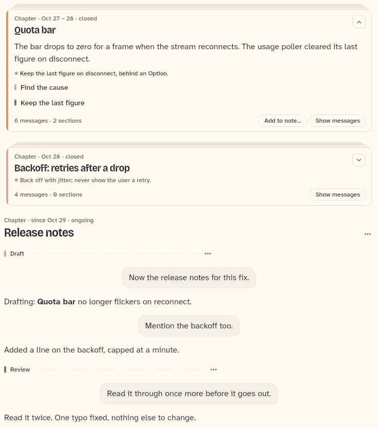
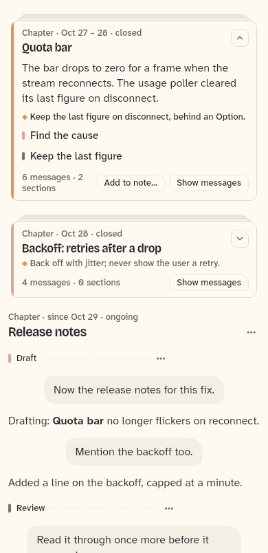

# OutlineList

The outlined transcript as a list: the rows of an `OutlineController`'s layout, drawn in an `AnchoredList`. Chat items come from the host; chapter cards, chapter headings and section dividers come from the kit. Also documented here: `AnchoredList`, `AnchoredListController`, `OutlineController` and `showOutlineContents`.

```dart
import 'package:agent_kit/agent_kit.dart';
```

## Demo

<picture>
  <source media="(prefers-color-scheme: dark)" srcset="shots/outline_list-dark.png">
  
</picture>

*Wide, 1600 px: "Quota bar" is open and shows its summary, decision and two sections, with "Add to note…" and "Show messages" in the foot. "Backoff" is a closed card. "Release notes" is the ongoing chapter: a heading with no card, two section dividers and the messages. The gallery opens the first card with `fold.expanded['m0'] = true`.*

<picture>
  <source media="(prefers-color-scheme: dark)" srcset="shots/outline_list_compact-dark.png">
  
</picture>

*Compact, 390 px: the same outline. The first card's count line wraps to two lines beside its buttons. The gallery passes `padding` of 12 px on each side at this width (32 px otherwise).*

## Parameters

| Parameter | Type | Notes |
|---|---|---|
| `controller` | `OutlineController` (required) | Holds the layout, fold state, where-am-I notifier and `AnchoredListController`. Rebuild the list when its state changes and after each `sync`. |
| `itemBuilder` | `Widget Function(BuildContext, ItemRow)` (required) | The widget of a chat item. The kit adds no keys inside it. |
| `chapterActions` | `List<OutlineAction> Function(OutlineChapter)?` | Entries of the chapter heading's menu. Null or empty leaves the menu button out. |
| `sectionActions` | `List<OutlineAction> Function(OutlineChapter, OutlineSection)?` | Entries of a section divider's menu. Null or empty leaves its button out. |
| `cardActions` | `List<OutlineAction> Function(OutlineChapter)?` | Buttons in the foot of an open chapter card. Null or empty adds none. |
| `padding` | `EdgeInsets` | Default `EdgeInsets.zero`. The host sets the gutter. |
| `contentWidth` | `double` | Default `Layout.contentWidth` (bb_ui). Rows are centred in a column this wide. |
| `initialIndex` | `int?` | Row index the list starts at, read by `AnchoredList`. |
| `initialY` | `double` | Default `0`. Offset within `initialIndex`. |
| `initialGlobalY` | `double?` | Start offset in global coordinates, read by `AnchoredList`. |

`OutlineAction` (in `outline_chapter_widgets.dart`): `label` (required), `onSelected` (required), `icon` (`Ico?`, shown in menus). The kit only shows and calls it.

## Behaviour

Rows come from `OutlineController.layout`, and each row is one of:

- An item row: the host's `itemBuilder` output, centred in `contentWidth`, in a `SizeTransition` that collapses with its chapter.
- A chapter row:
  - an ongoing chapter (`chapter.ongoing`): `OutlineChapterHeading`, with the menu when `chapterActions` gives entries;
  - a chapter in `fold.deferred`: `OutlineChapterHeading` with `closed: true` and the "Chapter closed · Fold" line;
  - any other chapter: `OutlineChapterCard`, open when `fold.expanded` is true for its first item, with messages shown unless folded or collapsing.
- A section row: `OutlineSectionDivider`, with the menu when `sectionActions` gives entries.

Flash: a row whose key is in `controller.flashKeys` is wrapped in `OutlineFlash`, which tints it after a jump (see `OutlineWhereStrip`).

## Theme roles

`OutlineList` itself reads no theme role. The rows it draws read `colors.textPrimary`, `textSecondary`, `textTertiary`, `borderSubtle`, `iconTertiary`, `typeScale.body`, `typeScale.ui`, `typeScale.uiSmall` and `typeScale.h2`. Chapter colours come from `outlineColor` (the space palette for the theme's brightness, `colors.accent` as fallback).

## Size classes

Does not read the size class. The gallery picks `padding` from `SizeClassBuilder` (12 px compact, 32 px otherwise). The list centres rows in `contentWidth`.

## Accessibility

- The "More" button on a chapter heading or a divider has `Semantics(button: true, label: 'More')` and an `AppTooltip` labelled "More".
- A closed chapter's "Fold" line is a `Hover` with `onTap`; it has no separate label.
- Keys for tests: `outline-chapter-<id>`, `outline-section-<row key>`, `outline-chapter-menu-<id>`, `outline-section-menu-<id>`, `outline-card-show-<id>`, `outline-card-action-<id>-<i>`.
- No reduced-motion handling in the outline folder. The collapse and flash animations run regardless.

## AnchoredList

`AnchoredList` (`anchored_list.dart`) lays out rows by index without measuring the rows between. The viewport is rebased at the chosen row, and history stays scrollable both ways. Its inputs are `controller` (an `AnchoredListController`), `itemCount`, `itemBuilder`, the optional `onTopIndexChanged` and `onVisibleRangeChanged`, `keyOf` and `indexOf` (the row keys the fold state provides, so a row keeps its identity across folds), `padding`, and the `initialIndex` / `initialY` / `initialGlobalY` start position.

`AnchoredListController` is the handle the host and the fold state use: `jumpToIndex(index)`, `jumpToEnd()`, `pinTop()` (keeps the top visible row in place before a height change above or below it) and `dispose()`.

## OutlineController

`OutlineController({required TickerProvider vsync, required bool Function() mounted, required void Function(VoidCallback) update})`. The host owns it and calls `dispose`.

- `sync({outline, itemIds, anchorIds, anchorOf, topAnchorId})` builds the `OutlineLayout` and returns it. Call it on every build.
- `layout`, `outline`, `fold` (`OutlineFoldState`), `list` (`AnchoredListController`), `where` (`ValueNotifier<OutlineWhere>`), `flashKeys` and `flashToken`.
- `toggleMessages(chapter, shown)`, `openChapter(chapter)`, `openSection(section)`, `jump(first, last, {sectionKey})`, `onVisible(first, last)`, `refreshWhere()`, `chaptersInView()`, `reset()`.

`OutlineControllerContents.showContents(context)` (an extension in `outline_list.dart`) opens `showOutlineContents` with the controller's state. See `OutlineWhereStrip` for the strip that calls it.

## Gallery and tests

- Gallery scene: Outline (`GalleryScene.outline`, `apps/gallery/lib/src/outline_scene.dart`, `OutlineScene`). Its fixture has three chapters: "Quota bar" (closed, first card open), "Backoff" (closed) and "Release notes" (ongoing).
- Golden: `apps/gallery/test/component_shots_test.dart` writes `outline_list` (1600 by 900, with the card and an assistant message, pad 8) and `outline_list_compact` (390 by 844, index 0 of `OutlineList`, pad 0), each `_light.png` and `_dark.png`. The whole scene is in `apps/gallery/test/goldens/g_outline_1600_<theme>.png` and `g_outline_390_<theme>.png` (`scenes_golden_test.dart`).
- Other tests:
  - `apps/gallery/test/outline_scene_test.dart`: "the outline scene shows chapters, and a card unfolds".
  - `packages/agent_kit/test/outline/outline_test.dart`: "a closed chapter shows as a card, its messages open under it"; "folding and unfolding keeps the other rows keys stable"; "the contents name a chapter and jump to it"; "a contents section jump reveals its divider and names it"; "a jump lands on the item of its anchor and flashes the span"; "a jump to an unknown span does nothing"; "a jump highlights its target, and the highlight fades"; "host actions appear on an open card and fire"; "chapter and section menus list the host actions"; "without host actions there is no menu button"; "an empty outline shows only the items"; "a chapter that closes while the reader is inside it stays"; "the contents fit a phone: the list scrolls inside the sheet".
  - `packages/agent_kit/test/outline/outline_layout_test.dart`: the layout rules (titles, gists, sections, folding, anchors and segments).
  - `packages/agent_kit/test/outline/outline_harness.dart`: the shared harness; no golden of its own.
