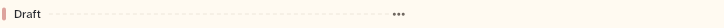

# OutlineSectionDivider

A section's divider in the outline: a short coloured bar, the section title, a dashed rule and an optional menu button. It sits between the messages of a section.

```dart
import 'package:agent_kit/agent_kit.dart';
```

## Demo

<picture>
  <source media="(prefers-color-scheme: dark)" srcset="shots/outline_section_divider-dark.png">
  
</picture>

*Section "Draft": the first section of the open chapter "Release notes". The gallery's `OutlineList` gives it the colour `outlineColor(context, 1)`, and the menu button is present because the scene passes `sectionActions`.*

## Parameters

| Parameter | Type | Notes |
|---|---|---|
| `section` | `OutlineSection` (required) | Read: `id`, `title`. |
| `color` | `Color` (required) | The colour of the short bar at the left. |
| `onMenu` | `VoidCallback?` | Opens the host's menu. The "More" button is left out when it is null. |

## Behaviour

- A 4 by 13 px bar in `color`, then the section title (one line, ellipsised, `typeScale.uiSmall`, `textPrimary`), then a dashed rule that fills the remaining width, then the menu button.
- The menu button (`outline-section-menu-<id>`) appears only when `onMenu` is not null.

## Theme roles

`colors.textPrimary` (section title), `colors.borderSubtle` (dashed rule, through the private `_DashedLinePainter`: 4 px dashes every 7 px), `typeScale.uiSmall` (title), `colors.iconTertiary` (menu button, through `OutlineMoreButton`).

## Size classes

Does not read the size class. The title takes at most the space the dashed rule leaves; a long title is ellipsised.

## Accessibility

- The title is a text node. The bar and the rule carry no semantics.
- The menu button is `OutlineMoreButton`: `Semantics(button: true, label: 'More')` with an `AppTooltip` labelled "More".
- No reduced-motion handling in this file.

## Gallery and tests

- Gallery scene: Outline (`GalleryScene.outline`, `OutlineScene`). The dividers are the sections "Draft" and "Review" of "Release notes".
- Golden: `apps/gallery/test/component_shots_test.dart` writes `outline_section_divider` (index 0), `_light.png` and `_dark.png`. The scene is in `g_outline_1600_<theme>.png` and `g_outline_390_<theme>.png`.
- Other tests, `packages/agent_kit/test/outline/outline_test.dart`: "a contents section jump reveals its divider and names it"; "chapter and section menus list the host actions"; "without host actions there is no menu button".
