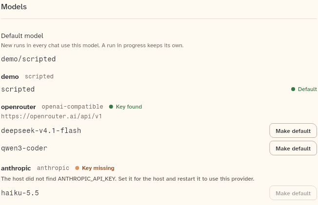
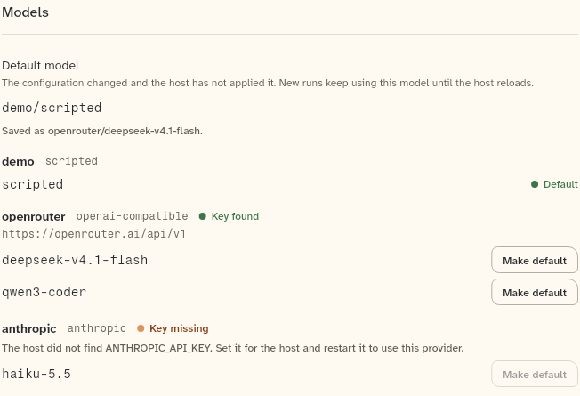
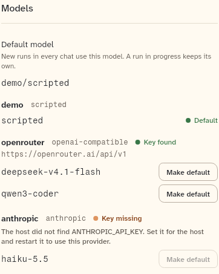

# ProviderSettings

The providers section of a host's settings, with the default model, each provider's key status and models, and Make default: `ProviderList` draws a `ProviderSetup`, and `ProviderSettings` loads it from an `AgentBackend` and runs Make default.

```dart
import 'package:agent_kit/agent_kit.dart';
```

## Demo

<picture>
  <source media="(prefers-color-scheme: dark)" srcset="shots/provider_list-dark.png">
  
</picture>

*Idle (`ProviderList`, 680 px): the default model is `demo/scripted` and no change is pending. The `anthropic` key is missing, so its model's Make default button is drawn disabled.*

<picture>
  <source media="(prefers-color-scheme: dark)" srcset="shots/provider_list_restart-dark.png">
  
</picture>

*Restart pending (`ProviderList`, 680 px): the setup has `reloadNeeded` set and `main` differs from `activeMain`. The default model shows the saved model, with "Saved as openrouter/deepseek-v4.1-flash.", and the description says the host has not applied it.*

<picture>
  <source media="(prefers-color-scheme: dark)" srcset="shots/provider_list_phone-dark.png">
  
</picture>

*Phone (`ProviderList`, 390 px box): the same idle setup. The descriptions wrap, and the Make default buttons stay on each model's row.*

## Parameters

`ProviderList`:

| Parameter | Type | Notes |
|---|---|---|
| `setup` | `ProviderSetup` | required. The providers and the default model. |
| `onMakeDefault` | `ValueChanged<String>?` | Takes `provider/model`. Null shows the list without the Make default buttons. |
| `makingDefault` | `String?` | The `provider/model` being set. Its button reads "Making default…" and is disabled, and the other buttons are disabled while it runs. |
| `error` | `String?` | The last failure, in words for the user. Shown under the list. |

`ProviderSettings`:

| Parameter | Type | Notes |
|---|---|---|
| `backend` | `AgentBackend` | required. Providers come from `listProviders`. Make default calls `setDefaultModel`, and the buttons appear only when the backend has the `defaultModel` capability. Without the `providers` capability the widget draws nothing. |

## Theme roles

`BbTheme` roles read in `provider_settings.dart`:

- `typeScale.ui` and `typeScale.uiSmall`: all text.
- `ink`: the default model, provider names and model ids.
- `muted`: descriptions, the "Saved as" line, the empty and unusable-key notes, and the "lists no models" note.
- `faint`: the default model when none is set, the provider kind, the base URL and the loading text.
- `dangerInk`: the error line and the load error.

The "Key found", "Key missing" and "Default" marks are `StatusMark` (`status/`), which reads the status roles.

## Size classes

Neither widget reads the size class. The width comes from the host. The base URL and the model ids are one line each and end with an ellipsis when they do not fit (`maxLines: 1`, `TextOverflow.ellipsis`; `provider_settings.dart:166-167`, `:246-247`). The description text wraps.

## Accessibility

- The host reports only whether a key is present. No widget here reads, shows or stores a key (`provider_settings.dart:1-4`).
- The error line of `ProviderList` is a live region (`provider_settings.dart:103`) with the key `provider-error`.
- Each Make default button has the semantic label "Make `provider/model` the default model" (`:233`). While it runs, the button reads "Making default…".
- A model whose provider key is missing has a disabled Make default button (`onTap` is null).
- `ProviderSettings` shows "Loading providers…" while it loads. A failed load shows "Could not load the providers." with the reason and a "Try again" button (`:361`, `:372`). These texts are not live regions.
- The "Key found" and "Key missing" marks carry their labels through `StatusMark`.

## Gallery and tests

- Gallery: the Components scene's "Providers" heading (`apps/gallery/lib/src/components_scene.dart:42-43`) draws `ProviderSpecimens` (`apps/gallery/lib/components/providers.dart`). The specimens are three `ProviderList`s: idle at 680 px, restart pending at 680 px, and idle at 390 px, each with `onMakeDefault` set to a no-op. `ProviderSettings` has no gallery specimen.
- Shots: `apps/gallery/test/component_shots_test.dart:127-129` crops the three `ProviderList` specimens from the Components sheet (rendered 1100 px wide, `:49`), light and dark, to `goldens/shots/`. The shots `provider_list`, `provider_list_restart` and `provider_list_phone` are copies of those.
- Whole sheet: `apps/gallery/test/scenes_golden_test.dart` covers the Components sheet at 1000 px (`components_1000_<theme>.png`).
- Other tests:
  - `packages/agent_kit/test/providers/provider_settings_test.dart`. `ProviderList`: names providers, keys and the default; a provider without a key requirement is usable; Make default is off for a missing key; no setter means no buttons; a pending change says what is saved; an empty host says how to add a provider; the busy model says so. `ProviderSettings`: loads the providers and makes a model the default; a refused change says why; a failed load can be tried again; without `defaultModel` the list is read-only; without `providers` nothing shows.
  - `packages/agent_kit/test/providers/provider_golden_test.dart`: `ProviderList` at 680 px and 390 px, light and dark, against `packages/agent_kit/test/goldens/provider_settings_680_<theme>.png` and `provider_settings_390_<theme>.png`.
  - `packages/agent_kit/test/providers/provider_samples.dart`: the shared sample setup for those tests.
