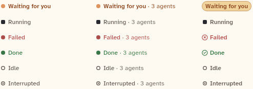

# StatusMark

The one widget that draws a status: a small mark and a label, in a dot form for list rows and meta lines, or a pill form for headers. Every status surface puts one next to its text. Also documented here: `StatusMarkVariant`, `statusLabel` and `statusOfWork`.

```dart
import 'package:agent_kit/agent_kit.dart';
```

## Demo

<picture>
  <source media="(prefers-color-scheme: dark)" srcset="shots/status_mark-dark.png">
  
</picture>

*Three columns, six rows. The gallery builds each `ChatStatus` in enum order (needs you, running, failed, done, idle, interrupted) three times: the dot form with no detail, the dot form with `detail: '3 agents'`, and the pill form. In the pill column, "Waiting for you" is a filled, outlined pill; the other statuses show a status icon (or the same mark as the dot form) with the label.*

`StatusMark.work` and `StatusMark.askingParent` do not appear in the shot. The work-state mapping is covered by a unit test (see Gallery and tests).

## Parameters

| Parameter | Type | Notes |
|---|---|---|
| `status` | `ChatStatus` (required, positional) | The status to show. The named constructors set it themselves (`pill`, `askingParent`) or derive it from a work state (`work`). |
| `variant` | `StatusMarkVariant` | Default `StatusMarkVariant.dot`. `dot` is for list rows and meta lines; `pill` is for headers. `StatusMark.pill` sets it. |
| `label` | `String?` | Replaces the default label from `statusLabel(status)`. |
| `detail` | `String?` | Follows the label after " · " in the same ink at 80% alpha. It does not replace the label. |
| `animate` | `bool` | Default `true`. `false` keeps the running mark still. |

Named constructors:

- `StatusMark.pill(ChatStatus status, {label, detail, animate})`: the pill form.
- `StatusMark.work(WorkState state, {variant, label, detail, animate})`: maps the state with `statusOfWork`. A `waitingForAnswer` state gives the "asking parent" mark.
- `StatusMark.askingParent({variant, label, detail, animate})`: a child waiting for its parent's answer. A static speech-bubble glyph in the "asking" ink, labelled "Asking parent". It is not "needs you" and does not count as running.

`statusOfWork`: `running` to running; `done` to done; `failed` and `timedOut` to failed; `cancelled`, `waitingForAnswer` and `idle` to idle.

## Forms by status

Dot form: `needsYou` is a filled dot in the mark colour and its label is weight 600. `running` is a breathing square. `failed` and `done` are filled dots. `idle` is a hollow ring (1.5 px border). `interrupted` is a ring with a small dot inside.

Pill form: `needsYou` is a filled pill with a hairline border and the label in the attention ink (12 px, weight 600). `failed` shows a circle-X icon and `done` a circle-check icon. `running`, `idle` and `interrupted` show the same mark as the dot form.

## Theme roles

`statusStyle(status)` gives `BbStatusStyle` with `mark` (glyph colour), `ink` (text and icon colour), `fill` and `line` (pill, `needsYou` only). `askingParent` gives the asking mark and ink. Roles read: `typeScale.uiSmall` (dot-form label), `spacing.xs` (gap between mark and label), `radii.pill` (pill shape), `motion.breathe` (running loop period).

The colour values come from the `statusNeedsYou*`, `statusRunning*`, `statusFailed*`, `statusDone*`, `statusIdle*` and `statusInterrupted*` palette entries in `bb_ui`. They are not defined in this repository.

## Size classes

Does not read the size class. Both forms ellipsise on one line (`maxLines: 1`). The dot form is wrapped in `Flexible`. The pill form is a fixed 12 px / 18 px label whatever the form factor.

## Accessibility

- The mark (dot, square, ring, icon) is wrapped in `ExcludeSemantics`, so only the text is read.
- The running mark stops breathing when `animate` is false, or when `BbTheme.reducedMotion(context)` is true. It then holds at full strength.
- No tooltip, key shortcut or extra `Semantics` label.

## Gallery and tests

- Gallery scene: Components (`GalleryScene.components`). Specimen: `_StatusSpecimens` in `apps/gallery/lib/src/components_scene.dart`. It builds `StatusMark(s)`, `StatusMark(s, detail: '3 agents')` and `StatusMark.pill(s)` for each `ChatStatus.values` entry.
- Golden: `apps/gallery/test/component_shots_test.dart` writes `status_mark` (indices 0 to 17, `_light.png` and `_dark.png`). The whole sheet is in `apps/gallery/test/goldens/components_1000_<theme>.png`.
- Other tests:
  - `packages/agent_kit/test/status_mark_test.dart`: "every status shows its label in both variants"; "a custom label and a detail replace the default" (the label replaces the default, the detail follows it); "work states map to statuses"; "the running mark breathes, and stops when motion is reduced".
  - `packages/agent_kit/test/status_mark_golden_test.dart` (tag `golden`): "status marks, light" and "status marks, dark", writing `packages/agent_kit/test/goldens/status_mark_light.png` and `status_mark_dark.png`.
  - `packages/agent_kit/test/transcript/transcript_test.dart` uses `StatusMark` (expects two in one view).

## Related types

- `StatusMarkVariant` (`dot`, `pill`).
- `statusLabel(ChatStatus)`: the default labels: "Waiting for you", "Running", "Failed", "Done", "Idle", "Interrupted".
- `statusOfWork(WorkState)`: see above.
- `ChatStatus` and `WorkState` come from `agent_kit_core`.
