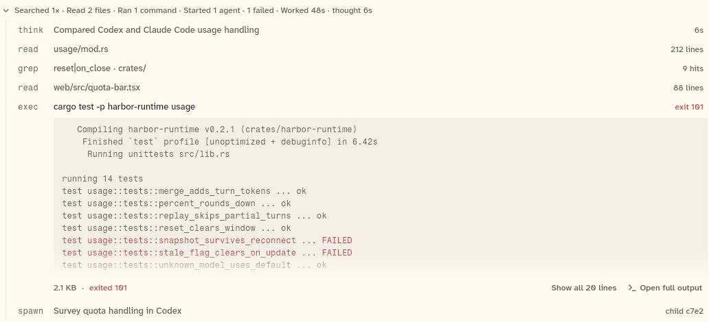
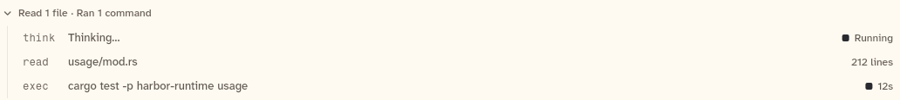
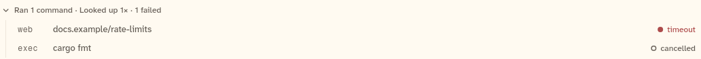

# ActivityGroupView

One summary line for a run of agent work ("Searched 1× · Read 2 files · Ran 1 command · Worked 48s") that opens into evidence rows. One row is open at a time. This sheet also covers `EvidenceRow` (one row: thinking, tool, or spawn) and `activitySummary` (the default summary line).

```dart
import 'package:agent_kit/agent_kit.dart';
```

## Demo

<picture>
  <source media="(prefers-color-scheme: dark)" srcset="shots/activity_group_collapsed-dark.png">
  
</picture>

*Collapsed: `initiallyOpen: false`. The summary line only.*

<picture>
  <source media="(prefers-color-scheme: dark)" srcset="shots/activity_group_open-dark.png">
  
</picture>

*Open, with the exec row open: `initiallyOpen: true, initiallyOpenRow: 'r5'`. The output is clamped to 12 lines, with the footer "2.1 KB · exited 101", "Show all 20 lines" and "Open full output". The spawn row shows "child c7e2".*

<picture>
  <source media="(prefers-color-scheme: dark)" srcset="shots/activity_group_running-dark.png">
  
</picture>

*Running: `initiallyOpen: true` on a group whose rows are still running. The summary has no time yet, and the running rows carry the running mark.*

<picture>
  <source media="(prefers-color-scheme: dark)" srcset="shots/activity_group_mixed-dark.png">
  
</picture>

*Failed and cancelled rows: `initiallyOpen: true`. The web row shows its meta, "timeout", with the failed mark; the exec row shows "cancelled". The gallery places this group under the "thinking text open, failed and cancelled rows" label.*

## Parameters

**ActivityGroupView**

| Parameter | Type | Notes |
|---|---|---|
| `group` | `ActivityGroup` | Required, positional. Its `rows` are the evidence. |
| `initiallyOpen` | `bool?` | Whether the evidence starts open. Default: `group.isRunning`. |
| `initiallyOpenRow` | `String?` | Id of the row that starts open. |
| `onOpenOutput` | `ValueChanged<ToolRow>?` | "Open full output" on an exec row. Not drawn when null. |
| `onOpenChild` | `ValueChanged<String>?` | Gets the child's id when a spawn row is tapped. A spawn row is not tappable without it. |
| `summaryOf` | `ActivitySummaryBuilder?` | Replaces the summary line. Default `activitySummary`. |
| `footer` | `Widget?` | Drawn under the rows while the group is open. |

**activitySummary** (the default summary, from verb counts)

- Parts, in order: "Searched N×" (search), "Read N file(s)" (read), "Edited N file(s)" (edit and write), "Ran N command(s)" (exec), "Looked up N×" (web), "Started N agent(s)" (spawn), "N other call(s)", "N failed".
- Time is appended only when the backend sent durations: "Worked <time>" from the earliest start to the latest end of the tool rows, and "thought <time>" from `thinkingMs`. The summary reads "Working" while a group with no calls runs, and "Worked" after it ends if there are no times.

**EvidenceRow** (one row; `row` is an `ActivityRow`)

- Thinking row: verb `think`; target is the first line of the reasoning text, or "Thinking…" while streaming, or "Thought"; the reasoning text opens below it when the backend sent it. The meta is a running mark while streaming, otherwise the duration.
- Tool row: verb from the kind (`read`, `grep` for search, `exec`, `edit`, `write`, `web`, or the tool's name for other); target is `target`, else `arguments`, else `name`. The meta is `exit N` in danger when the exit code is not zero, else a status mark for running, failed, timed out and cancelled, else the meta text. A tool row with non-empty output opens into `ExecOutput`, whatever its kind.
- Spawn row: verb `spawn`; target is the task; meta `child <last four characters of the child id>`. Tapping calls `onOpenChild`.

## Theme roles

- `ActivityGroupView`: `colors.borderSubtle` (the left rule of the evidence), `typeScale.uiSmall` and `faint` (summary line).
- `EvidenceRow`: `faint` (verb and meta), `ink` (target when open), `muted` (target when closed), `dangerInk` (exit meta). The sizes are fixed in the file, not from `typeScale`: the target is 13/16 weight 500, the verb is 12/16 mono.
- `isTouch` sets the padding of the summary and rows.

## Size classes

`ActivityGroupView` and `EvidenceRow` read `sizeClassOf(context).isCompact`, which is the class of the nearest `SizeClassBuilder` (the transcript list's own width).

- Compact: the verb column is 40 px (44 px otherwise), and the evidence body is not indented (0 px; 58 px otherwise).
- The summary line is one line with an ellipsis, in every class.

## Accessibility

- Summary line: `Semantics(button: true, expanded: _open, label: <summary>, excludeSemantics: true)`.
- Evidence row: `Semantics(button: tap != null, expanded: <when it has a body>, label: '<verb> <target>', excludeSemantics: true)`.
- Status marks inside rows carry their own labels (see `status.dart`, not read here).
- `transcript_test.dart` line 196 sends Enter to the focused summary and checks that it expands. The folder adds no key handler of its own, so the key handling comes from bb_ui's `Hover`, which this sheet did not read.
- No reduced-motion handling in this file. The chevron animates through `DisclosureChevron` (see `transcript_support.dart`).

## Gallery and tests

- Gallery scene: Components. Specimens in `TranscriptSpecimens` (`apps/gallery/lib/components/transcript.dart`): "Activity group: collapsed" (line 70), "open, exec output clamped" (72), "running, thinking streaming" (80), "thinking text open, failed and cancelled rows" (82), and the mixed group that follows it with no label of its own (91).
- Golden: `apps/gallery/test/component_shots_test.dart` writes `activity_group_collapsed` (index 1), `activity_group_open` (2), `activity_group_running` (3) and `activity_group_mixed` (5), light and dark. Index 0 is the group inside the transcript list.
- Other tests, in `packages/agent_kit/test/transcript/transcript_test.dart`: "summary line" (line 132), "a footer shows under the rows only while open" (172), "a host can replace the summary line" (185), "Enter on the focused summary expands it" (196), "opens into rows, one at a time" (219), "the exit status is in danger" (253), "a spawn row opens the child" (262), and "running and failed tool rows use the status mark" (276).
- Transcript goldens in `packages/agent_kit/test/goldens/transcript_turn_*.png` and `transcript_states_*.png`.
