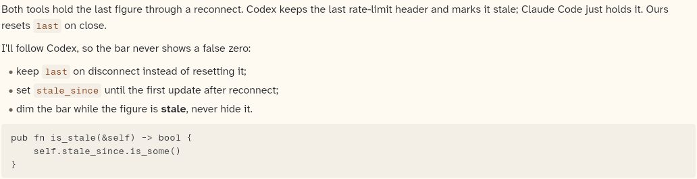

# AssistantProse

The assistant's message text, drawn by a `MarkdownRenderer`. The default renderer is `LeanMarkdownRenderer` (in `markdown.dart`); its inline text is drawn by `MarkdownText`. This sheet covers `AssistantProse`, `MarkdownText`, `MarkdownRenderer` and `LeanMarkdownRenderer`.

```dart
import 'package:agent_kit/agent_kit.dart';
```

## Demo

<picture>
  <source media="(prefers-color-scheme: dark)" srcset="shots/assistant_prose-dark.png">
  
</picture>

*Default renderer: a prose message with paragraphs, a bullet list, inline code, bold text and a fenced block. The gallery takes this as the second `AssistantProse` in the Components scene; the first is the copy inside the transcript list.*

## Parameters

**AssistantProse**

| Parameter | Type | Notes |
|---|---|---|
| `message` | `AssistantMessage` | Required, positional. Its `markdown` is rendered; its `streaming` flag is passed to the renderer. |
| `renderer` | `MarkdownRenderer` | Default `LeanMarkdownRenderer()`. A host can pass its own renderer for tables, images or syntax colours. |
| `onLinkTap` | `ValueChanged<String>?` | Called with the target of a tapped `[label](target)` link. Without it, links are drawn but do not respond to taps. |

**MarkdownText** (inline runs of one block)

| Parameter | Type | Notes |
|---|---|---|
| `text` | `String` | Required, positional. Inline markdown: `code`, `**bold**`, `*italic*`, `[link](target)`, and backslash escapes. |
| `style` | `TextStyle` | Required. The base style of the paragraph. |
| `onLinkTap` | `ValueChanged<String>?` | As above. |

**LeanMarkdownRenderer**: supports paragraphs, headings, bullet and numbered lists (nested by two-space indent, levels 0 to 3), block quotes, fenced code, horizontal rules, and the inline forms above. Headings of level 1 and 2 use `typeScale.h3`; deeper headings use bold body text. The `streaming` argument is accepted but not used; an unclosed fence runs to the end of the text (`parseMarkdownBlocks`).

## Theme roles

- `MarkdownText`: `accentInk` (link text and underline), `codeBackground` and `codeInk` (inline code), `radii.sm` (inline code corners).
- Blocks in `LeanMarkdownRenderer`: `typeScale.body` and `ink` (paragraphs), `typeScale.h3` (headings 1 and 2), `thread` (quote rule), `muted` (quote text), `faint` (list markers), `seam` (horizontal rule). Code blocks use `CodeBlock`.

## Size classes

Does not read the size class. Text wraps to the width the transcript list gives it. Lists are indented by `6 + level × 18` px.

## Accessibility

None in the code. Links are tappable text spans (`TapGestureRecognizer`) with no Semantics label and no keyboard handling.

## Gallery and tests

- Gallery scene: Components. Specimen "Assistant prose (default markdown renderer)" in `TranscriptSpecimens` (`apps/gallery/lib/components/transcript.dart`).
- Golden: `apps/gallery/test/component_shots_test.dart` writes `assistant_prose`, which takes the second `AssistantProse` in the scene (light and dark).
- Other tests, in `packages/agent_kit/test/transcript/transcript_test.dart`:
  - "splits blocks" (line 25), "an open fence runs to the end" (37), "numbered lists, headings and quotes" (42), and "inline runs" (49), which test the parser;
  - "the default renderer draws prose and a code block" (58);
  - "a link calls back" (73).
- Transcript goldens in `packages/agent_kit/test/goldens/transcript_turn_*.png` and `transcript_states_*.png`.
