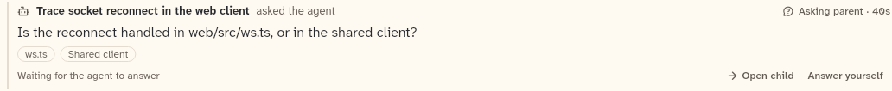
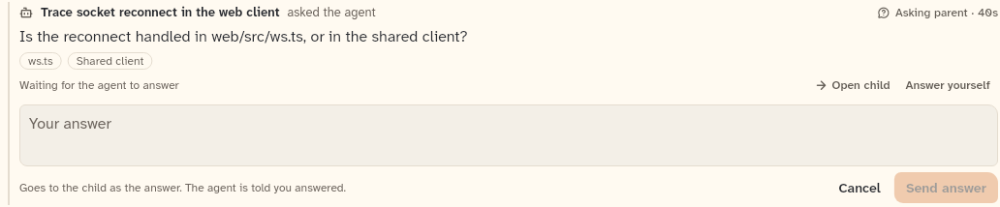
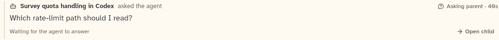
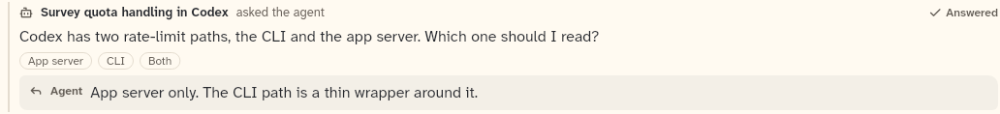
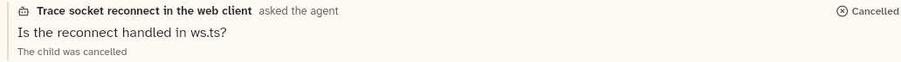

# ChildQuestionRow

A question a child agent asked its parent agent, shown as a quiet inline row with the child's suggested options, its status, and optionally a field for the user to answer it instead of the parent.

```dart
import 'package:agent_kit/agent_kit.dart';
```

## Demo

<picture>
  <source media="(prefers-color-scheme: dark)" srcset="shots/child_question_pending-dark.png">
  
</picture>

*Pending: the first `ChildQuestionRow` in the gallery's "Pending" group. It has `onOpenChild` and `onAnswer`, so both actions show. The options are outline chips; they are not buttons.*

<picture>
  <source media="(prefers-color-scheme: dark)" srcset="shots/child_question_composing-dark.png">
  
</picture>

*Composing: `initialComposing: true`. The field is empty, so Send answer is disabled. The note under the field says where the answer goes.*

<picture>
  <source media="(prefers-color-scheme: dark)" srcset="shots/child_question_no_answer-dark.png">
  
</picture>

*Pending without an answer handler: no `onAnswer`, so "Answer yourself" is not drawn. Only Open child remains.*

<picture>
  <source media="(prefers-color-scheme: dark)" srcset="shots/child_question_answered-dark.png">
  
</picture>

*Answered by the agent: the gallery's "Answered by the agent" row. The strip is labelled "Agent". The answered-by-you row (gallery "Answered by you") has no shot; its strip is labelled "You".*

<picture>
  <source media="(prefers-color-scheme: dark)" srcset="shots/child_question_cancelled-dark.png">
  
</picture>

*Cancelled: `state: cancelled`. No actions and no answer strip; the note reads "The child was cancelled".*

## Parameters

| Parameter | Type | Notes |
|---|---|---|
| `item` | `ChildQuestionItem` | Required, positional. Its `task` is the bold name (or "A child agent" when empty). Its `question` holds the text, `options`, `state`, `answer`, `answeredBy` and `askedAt`. |
| `now` | `DateTime?` | Replaces the wall clock for the wait time. Used by tests and the gallery. |
| `onOpenChild` | `ValueChanged<String>?` | "Open child", shown while pending. Gets the child's id. |
| `onAnswer` | `void Function(String childId, String questionId, String text)?` | Sends the user's answer. When null, "Answer yourself" is not drawn. |
| `initialComposing` | `bool` | Default false. Starts with the answer field open. |

Status by question state:

| State | Shown |
|---|---|
| pending | `StatusMark.askingParent`, "Asking parent · <wait>" |
| answered | check glyph and "Answered" |
| cancelled | X glyph and "Cancelled" |

The wait time is seconds under a minute (at least "1s"), then whole minutes under an hour ("4m"), then "Hh MMm". A pending row started with no `now` re-renders once a minute.

Actions, only while pending:

- "Open child" (with an arrow glyph): drawn when `onOpenChild` is set.
- "Answer yourself": drawn when `onAnswer` is set. It opens or closes the field.

The field holds at least two lines and at most six. "Send answer" sends `(childId, questionId, trimmed text)` through `onAnswer`, then closes the field. Enter inserts a newline; sending is by the button only. Send answer is disabled while the trimmed text is empty.

## Theme roles

- `seam`: the left rule, the option chips' outlines and the field's border.
- `surface2`: the answer strip and the field's well.
- `ink`: the task name, the question and the answer text. `muted`: the answered and cancelled status, the option text and the "Agent" or "You" label. `faint`: the notes and the field's hint.
- `colors.iconSecondary`: the bot glyph and the reply glyph. `colors.textSelection`: the field's selection.
- `typeScale.body` for the question and the answer; `typeScale.uiSmall` for the labels and notes. The task name is 13/18 at weight 700, fixed in the file.
- `radii.pill` for the option chips, `radii.field` for the strip and the field.

## Size classes

`ChildQuestionRow` reads `sizeClassOf(context).isCompact`. When compact:

- "asked the agent" is hidden after the task name;
- the waiting note sits on its own line, with the actions in a wrap on the line below, shifted left 8 px;
- when not compact, the note and the actions share one row of at least 28 px.

## Accessibility

- Row: `Semantics(container: true, label: 'Question from <task> to the agent')`.
- The answer field: `Semantics(label: 'Your answer to the child', textField: true, multiline: true)`. The hint "Your answer" is drawn as text, outside the field's semantics, and only while the field is empty.
- "Answer yourself" is wrapped in `Semantics(expanded: composing)`, so a screen reader reports whether the field is open.
- Opening the field requests focus on the next frame.
- The status and the answer are plain text. The "Open child", "Cancel" and "Send answer" controls are normal buttons, with their own semantics.
- Enter adds a newline, so Send answer has no keyboard shortcut.

## Gallery and tests

- Gallery scene: Components. Specimens "Child questions" in `ContextSpecimens` (`apps/gallery/lib/components/context.dart`, lines 189 to 271). Their order in the tree is pending (`k2`), composing (`k3`), no answer handler (`k4`), answered by the agent (`k1`), answered by you (`k5`) and cancelled (`k6`).
- Golden: `apps/gallery/test/component_shots_test.dart` writes `child_question_pending` (index 0), `child_question_composing` (1), `child_question_no_answer` (2), `child_question_answered` (3) and `child_question_cancelled` (5), light and dark. Index 4 (answered by you) has no shot.
- Widget tests, in `packages/agent_kit/test/transcript/child_question_test.dart`:
  - "pending: waits, offers Open child and Answer yourself" (line 61);
  - "Answer yourself is hidden without an answer handler" (line 85);
  - "composing sends (child, question, text)" (line 97);
  - "answered by the agent and by you, and cancelled" (line 120);
  - "the strip shows it, and it never reads as needs you" (line 158);
  - "Answer yourself reaches the backend" (line 203);
  - "without the capability there is no Answer yourself" (line 224).
- Golden test: `packages/agent_kit/test/transcript/child_question_golden_test.dart` writes `packages/agent_kit/test/goldens/child_question_<width>_<theme>.png` for widths 390 and 1000 (line 113).
