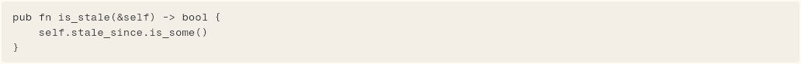

# CodeBlock

A fenced code block: mono text on a `surface2` well that scrolls sideways. It has no syntax colours; a host that wants them supplies its own `MarkdownRenderer`.

```dart
import 'package:agent_kit/agent_kit.dart';
```

## Demo

<picture>
  <source media="(prefers-color-scheme: dark)" srcset="shots/code_block-dark.png">
  
</picture>

*Code block with a language: the standalone specimen `CodeBlock(..., language: 'rust')`. The language is not drawn; it appears only in the semantics label.*

## Parameters

| Parameter | Type | Notes |
|---|---|---|
| `code` | `String` | Required, positional. The code, without the fences. |
| `language` | `String?` | The info string after the opening fence. Used only in the semantics label: `Code, <language>`. |

## Theme roles

`surface2` (well fill), `radii.sm` (corners), `ink` (text), `typeScale.code` (mono type, drawn through `monoStyle`, with `calt` and `liga` off).

## Size classes

Does not read the size class. The well fills the width it is given. Lines are not wrapped (`softWrap: false`); a wider line scrolls sideways inside the well.

## Accessibility

- `Semantics(container: true, label: 'Code' or 'Code, <language>')`. An empty or null language gives `Code`.
- No keyboard handling for the sideways scroll beyond the default of `SingleChildScrollView`.

## Gallery and tests

- Gallery scene: Components. Specimen "Code block" in `TranscriptSpecimens` (`apps/gallery/lib/components/transcript.dart`).
- Golden: `apps/gallery/test/component_shots_test.dart` writes `code_block`, which takes the second `CodeBlock` in the scene (index 1). The first is the copy inside the transcript list's assistant message. Light and dark.
- Other tests: `packages/agent_kit/test/transcript/transcript_test.dart`, "the default renderer draws prose and a code block" (line 58, expects one `CodeBlock`). Transcript goldens in `packages/agent_kit/test/goldens/transcript_turn_*.png` and `transcript_states_*.png`.
