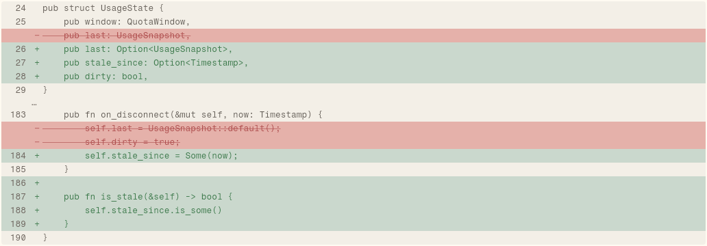

# DiffView

A file diff: one row per line, added lines on the constructive tint, removed lines on the danger tint with the text struck through, context on the surface-2 well. It is the body that a file edit row opens into.

```dart
import 'package:agent_kit/agent_kit.dart';
```

## Demo

<picture>
  <source media="(prefers-color-scheme: dark)" srcset="shots/diff_view-dark.png">
  
</picture>

*A diff with two hunks, from the `_modified()` fixture in the gallery: the hunk at line 24, then a break marked "…", then the hunk at line 183. The crop is the second `DiffView` in the scene (index 1), the one under the "Diff view" label. The first `DiffView` is inside the open file edit row.*

## Parameters

| Parameter | Type | Notes |
|---|---|---|
| `diff` | `FileDiff` | Required, positional. Its `hunks` are drawn in order; `path`, `added` and `removed` feed the semantics label. |
| `lineNumbers` | `bool` | Default true. When true, draws the number gutter. When false, the rows start 8 px in and no numbers are drawn. |

Line numbers come from the new file. Numbering starts at each hunk's `newStart`. Context and added lines take the next number; a removed line has none and does not advance the count.

Line types (`DiffOp`):

| Op | Row fill | Text | Sign |
|---|---|---|---|
| `add` | `constructive` | `constructiveInk` | `+` |
| `del` | `danger` | `dangerInk`, struck through | `−` |
| `ctx` | `surface2` | `muted` | none (faint) |

An empty line is drawn as a space, so the row keeps its height. A hunk break is a 16 px row on `surface2` with a faint `…`; it is indented to clear the gutter (44 px, or 8 px without numbers).

## Theme roles

`constructive`, `constructiveInk`, `danger`, `dangerInk`, `surface2`, `muted`, `faint` (numbers, signs and the hunk break), and `radii.sm` (the clip corners).

The text is 12.5/20 mono, set through `monoStyle` from a fixed `TypeSpec` in the file, not from `typeScale.code`.

## Size classes

Does not read the size class. The diff lays out at the width its parent gives it. The inner `Column` is an `IntrinsicWidth`, and a horizontal scroll takes over when a line is wider than the viewport. Lines do not wrap (`softWrap: false`).

## Accessibility

- `Semantics(container: true, label: 'Diff of <path>, +<added> −<removed>')`. The rows underneath are not given their own labels.
- No focusable controls. Scrolling is the default of `SingleChildScrollView`; no key handling is added.

## Gallery and tests

- Gallery scene: Components. Specimen "Diff view" in `TranscriptSpecimens` (`apps/gallery/lib/components/transcript.dart`, lines 108 to 109), built from `_modified().diff`.
- Golden: `apps/gallery/test/component_shots_test.dart` writes `diff_view` from `DiffView` index 1, light and dark.
- Other tests, in `packages/agent_kit/test/transcript/transcript_test.dart`:
  - "counts, callbacks and the diff" (line 349);
  - "the diff numbers lines and strikes removals" (line 420).
- Transcript goldens in `packages/agent_kit/test/goldens/transcript_turn_*.png` and `transcript_states_*.png`.
