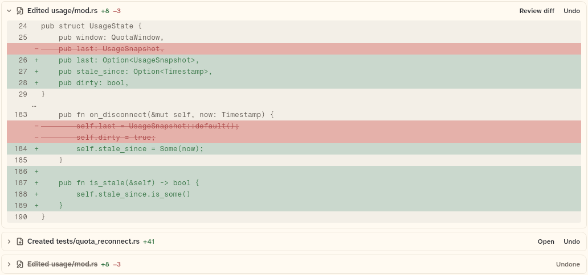

# FileEditRow

One file change: "Edited usage/mod.rs +N −N", with "Review diff", "Open" and "Undo" actions, and the diff opening under it. This sheet also covers `UndoRefused`, the exception an undo callback throws to show a message under the row.

```dart
import 'package:agent_kit/agent_kit.dart';
```

## Demo

<picture>
  <source media="(prefers-color-scheme: dark)" srcset="shots/file_edit_row-dark.png">
  
</picture>

*The three "Files / edit rows" specimens. First, a modified file with `initiallyOpen: true`, Review diff and Undo. Second, a created file with Open and Undo. Third, the same modified file with `undone: true`: its name is struck through, "Undone" replaces the buttons, and none are drawn even though `onReviewDiff` is set.*

## Parameters

| Parameter | Type | Notes |
|---|---|---|
| `edit` | `FileEdit` | Required, positional. Uses `diff` (path, change, hunks, added and removed counts), `label` (replaces the wording), `undone` and `undoable`. |
| `initiallyOpen` | `bool` | Default false. The diff starts open, but only when the diff has hunks. |
| `onReviewDiff` | `VoidCallback?` | "Review diff". Drawn for modified and deleted files when set, and never for created files. |
| `onUndo` | `FutureOr<void> Function()?` | "Undo". Drawn when `edit.undoable` is true, the edit is not undone and the callback is set. Reads "Undoing…" until the future completes, shows "Undo failed" beside it if the future throws, and shows an `UndoRefused` message under the row. |
| `onOpen` | `VoidCallback?` | "Open". For a created file it is the only action, when set. For modified and deleted files it is drawn only when `openEveryEdit` is true. |
| `openEveryEdit` | `bool` | Default false. Adds "Open" beside "Review diff" on modified and deleted files. |

Wording: the name is `edit.label` if set. Otherwise it is "Edited", "Created" or "Deleted" followed by `tailPath(diff.path)`, the last two segments of the path (`transcript_support.dart`). `+N` (constructive ink) and `−N` (danger ink) appear when the counts are above zero.

An undone edit (`undone: true`) draws no buttons at all: no Review diff, no Open, no Undo. Its name is struck through and "Undone" is shown in their place.

`UndoRefused(message)`: thrown by an undo callback that the host refused on purpose, for example because the file changed since. The row shows `message` under the header instead of "Undo failed".

## Theme roles

- `colors.borderSubtle` and `radii.field`: the row frame.
- `radii.sm`: the header's hover corners.
- `ink`: the name and the buttons.
- `faint`: the undone name, its strike-through line, and the "Undone" label.
- `typeScale.uiSmall`: "Undone", "Undo failed" and the refusal text.
- `colors.iconSecondary`: the file glyph.
- `constructiveInk`: `+N`. `dangerInk`: `−N` and "Undo failed".

The name is 13/16 at weight 600 and the counts are 12/16 at weight 600, both fixed in the file.

## Size classes

`FileEditRow` reads `sizeClassOf(context).isCompact`. When compact, the name is the path's last two segments with no verb ("usage/mod.rs"); otherwise it reads "Edited usage/mod.rs". The header row has a minimum height of 34 px. The header's hover target is 36 px on touch and 30 px otherwise (`isTouch`).

## Accessibility

- Header: `Semantics(button: hasBody, expanded: open when it has a body, label: '<verb> <full path>, +N −N', excludeSemantics: true)`. The label uses the full path, not the shortened one.
- Undo: while undoing, the button's `onTap` is null, so a second press does nothing. `_undo` also returns early when an undo is already running.
- "Undo failed" and the refusal text are plain `Text`, with no Semantics label of their own.
- The file does not handle keys itself. The header is a bb_ui `Hover` with `onTap`; any keyboard handling comes from `Hover`, which this sheet did not read.

## Gallery and tests

- Gallery scene: Components. Specimens "Files / edit rows" in `TranscriptSpecimens` (`apps/gallery/lib/components/transcript.dart`, lines 97 to 107).
- Golden: `apps/gallery/test/component_shots_test.dart` writes `file_edit_row` from `FileEditRow` indices 2 to 4, light and dark. Indices 0 and 1 are the edit and the created file inside the transcript list.
- Other tests, in `packages/agent_kit/test/transcript/transcript_test.dart`:
  - "counts, callbacks and the diff" (line 349);
  - "shows the last two segments of a Windows or a slash path" (377);
  - "a created file offers Open; an undone edit no Undo" (400);
  - "reads Undoing… until the future completes" (704);
  - "says Undo failed and allows another try" (732);
  - "a refusal shows its message instead of Undo failed" (755);
  - "a host label, and Open on every edit when asked" (774).
- Transcript goldens in `packages/agent_kit/test/goldens/transcript_turn_*.png` and `transcript_states_*.png`.
