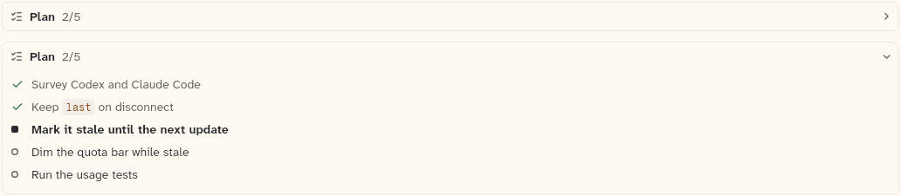

# PlanChecklist

The agent's plan as one line, "Plan 2/5", that opens into its steps. Done steps are checked and muted, the step in progress is bold with the running mark, and the rest carry the idle mark.

```dart
import 'package:agent_kit/agent_kit.dart';
```

## Demo

<picture>
  <source media="(prefers-color-scheme: dark)" srcset="shots/plan_checklist-dark.png">
  
</picture>

*Collapsed and open, from the gallery's "Plan: collapsed and open" label: the same five-step plan, with `initiallyOpen` false above and true below. The crop covers both, so the header count and the step marks can be compared in one picture.*

## Parameters

| Parameter | Type | Notes |
|---|---|---|
| `items` | `List<PlanItem>` | Required, positional. Each item has an `id`, the `text` (drawn as inline markdown) and a `state`. An empty list draws nothing (`SizedBox.shrink`). |
| `initiallyOpen` | `bool` | Default false. The checklist starts collapsed. |

`PlanItemState` values and what they draw:

| State | Text | Mark | Semantics |
|---|---|---|---|
| `done` | `muted`, weight 400 | check glyph in `constructiveInk` | "done" |
| `now` | `ink`, weight 700 | `StatusMark` for running | "in progress" |
| `todo` | `ink`, weight 400 | `StatusMark` for idle | "to do" |

The header reads "Plan" in bold with a count of done over total in faint text (`2/5`). The count is the number of items whose state is `done`, over the list's length.

## Theme roles

- `colors.borderSubtle` and `radii.field`: the frame.
- `ink` (the "Plan" label and open steps), `faint` (the count), `muted` (done steps), `constructiveInk` (the done check), `colors.iconSecondary` (the list glyph).
- `typeScale.ui` for the header and the step text, through `ts`.

## Size classes

Does not read the size class. The header's minimum height is 40 px on touch and 34 px otherwise (`isTouch`). Step rows have a minimum height of 26 px. Step rows use a 16 px mark box and an 8 px gap before the text.

## Accessibility

- Header: `Semantics(button: true, expanded: open, label: 'Plan, <done> of <total> done', excludeSemantics: true)`.
- Each step: `Semantics(container: true, label: '<text>, done | in progress | to do', excludeSemantics: true)`.
- The header is a bb_ui `Hover` with `onTap`, so it toggles on tap. Any keyboard handling comes from `Hover`, which this sheet did not read.
- Step marks have no labels of their own; the step's semantics label carries the state.

## Gallery and tests

- Gallery scene: Components. Specimens "Plan: collapsed and open" in `TranscriptSpecimens` (`apps/gallery/lib/components/transcript.dart`, lines 110 to 113), both built from the `_plan` fixture (five items: two done, one now, two to do).
- Golden: `apps/gallery/test/component_shots_test.dart` writes `plan_checklist` from `PlanChecklist` indices 0 and 1 together, light and dark. Index 0 is the collapsed one and index 1 the open one, so the picture has one of each.
- Other tests: in `packages/agent_kit/test/transcript/transcript_test.dart`, "one line that opens" (line 442) and "draws the plan, and inserts after their item" (line 671). Transcript goldens in `packages/agent_kit/test/goldens/transcript_turn_*.png` and `transcript_states_*.png`.
