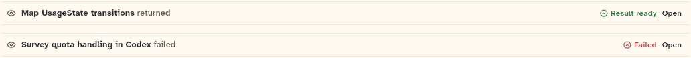

# ReturnLine

The line that closes a child agent's work: "Map UsageState transitions returned", with a status pill and an Open action for the child's chat. This sheet also covers `InterruptedNotice`, the line that closes a run stopped by a host restart, with Resume.

```dart
import 'package:agent_kit/agent_kit.dart';
```

## Demo

<picture>
  <source media="(prefers-color-scheme: dark)" srcset="shots/return_line-dark.png">
  
</picture>

*Done and failed: the two `ReturnLine` specimens from the gallery's "Return line and interrupted notice" group. The done line carries the "Result ready" pill; the failed line carries "Failed". Both show Open because the specimens pass `onOpen`.*

<picture>
  <source media="(prefers-color-scheme: dark)" srcset="shots/interrupted_notice-dark.png">
  
</picture>

*Interrupted: `InterruptedNotice(onResume: ...)` with the default text. The Resume button is drawn because the callback is set.*

## Parameters

**ReturnLine**

| Parameter | Type | Notes |
|---|---|---|
| `result` | `ChildResult` | Required, positional. Uses `task` (bold), `state` (the verb and the pill) and `childId`. |
| `onOpen` | `ValueChanged<String>?` | "Open". Gets `result.childId`. Not drawn when null. |

Verb and pill for each `WorkState`:

| State | Verb | Pill |
|---|---|---|
| `running` | is running | running |
| `done` | returned | "Result ready" (done) |
| `failed` | failed | failed |
| `cancelled` | was cancelled | "Cancelled" (idle) |
| `waitingForAnswer` | is waiting for an answer | idle |
| `idle` | is idle | idle |
| `timedOut` | timed out | "Timed out" (failed) |

**InterruptedNotice**

| Parameter | Type | Notes |
|---|---|---|
| `text` | `String` | Default "Interrupted by a restart". Drawn beside the interrupted mark. |
| `onResume` | `VoidCallback?` | "Resume", with a refresh glyph. Not drawn when null. |

In the chat pane, `onResume` is set only when the backend has `KitCapability.resume` (`packages/agent_kit/lib/src/compositions/agent_chat_pane.dart`, lines 571 to 574). Without it the notice has no button.

## Theme roles

- `colors.borderSubtle`: the top and bottom rules of both lines.
- `colors.iconSecondary`: the eye glyph on `ReturnLine`.
- `muted`: the verb. `ink`: the bold task name and the Open and Resume buttons.
- Pills and the interrupted mark come from `StatusMark`, so their colours are that widget's, not set here.

The text is 13/16 at weight 500, set from a fixed `TypeSpec` in the file, not from `typeScale`.

## Size classes

`ReturnLine` reads `sizeClassOf(context).isCompact`. When compact, the pill is hidden and Open stays. The task and verb text can wrap to two lines, then ellipsis. `InterruptedNotice` does not read the size class.

## Accessibility

- `ReturnLine`: `Semantics(container: true, label: '<task> <verb>')`. The Open button keeps its own button semantics.
- `InterruptedNotice`: `Semantics(container: true, label: <text>)`. The Resume button keeps its own button semantics.
- No keyboard handling in either file. Taps on the buttons are `KitTextButton`'s.

## Gallery and tests

- Gallery scene: Components. Specimens "Return line and interrupted notice" in `TranscriptSpecimens` (`apps/gallery/lib/components/transcript.dart`, lines 114 to 119). The results are `_childResult` (done, task "Map UsageState transitions") and `_childFailed` (failed, task "Survey quota handling in Codex").
- Golden: `apps/gallery/test/component_shots_test.dart` writes `return_line` from `ReturnLine` indices 1 and 2, and `interrupted_notice` from `InterruptedNotice` index 1, light and dark. Index 0 of each is inside the transcript list.
- Other tests, in `packages/agent_kit/test/transcript/transcript_test.dart`:
  - "a child result opens the child" (line 460);
  - "the interrupted notice resumes" (line 472).
- Transcript goldens in `packages/agent_kit/test/goldens/transcript_turn_*.png` and `transcript_states_*.png`.
