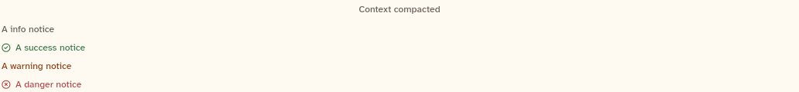

# SystemLineView

A system line: small, centred, faint text such as "Context compacted". This sheet also covers `NoticeLineView`, which is in the same file (`messages.dart`): a notice line in the colour of its tone, with an icon for success and danger.

```dart
import 'package:agent_kit/agent_kit.dart';
```

## Demo

<picture>
  <source media="(prefers-color-scheme: dark)" srcset="shots/system_notice_lines-dark.png">
  
</picture>

*System and notice lines: one `SystemLine` and one `NoticeLine` for each tone (info, success, warning, danger), as the Components specimens build them. The crop runs from the system line to the danger notice.*

## Parameters

**SystemLineView**

| Parameter | Type | Notes |
|---|---|---|
| `line` | `SystemLine` | Required, positional. Its `text` is drawn centred. |

**NoticeLineView**

| Parameter | Type | Notes |
|---|---|---|
| `line` | `NoticeLine` | Required, positional. Its `text` is drawn and its `tone` picks the colour and icon. |

Tone (`NoticeTone`) to look:

| Tone | Text colour | Icon |
|---|---|---|
| `info` | `muted` | none |
| `success` | `constructiveInk` | circle check |
| `warning` | `attentionInk` | none |
| `danger` | `dangerInk` | circle cross |

## Theme roles

- `SystemLineView`: `typeScale.uiSmall`, `faint`.
- `NoticeLineView`: `typeScale.uiSmall` (weight 500), and the tone colours above.

## Size classes

Does not read the size class. The system line is centred within the width it is given. The notice line's text is in an `Expanded`, so it wraps beside its icon.

## Accessibility

- `NoticeLineView`: `Semantics(container: true, label: line.text)`.
- `SystemLineView`: None in the code. It is a plain centred `Text`.

## Gallery and tests

- Gallery scene: Components. Specimen "System and notice lines" in `TranscriptSpecimens` (`apps/gallery/lib/components/transcript.dart`). The specimen text is "Context compacted" and "A info notice", "A success notice", and so on, one per tone.
- Golden: `apps/gallery/test/component_shots_test.dart` writes `system_notice_lines`, from the one `SystemLineView` (index 0) and the `NoticeLineView` at index 4, light and dark. The crop covers every line between them. The index 4 pick only lands on the danger line if the transcript list's warning notice counts as index 0; the crop shows that the danger line is at the bottom, so the pick is right (inferred from the crop, not from a run of the test).
- Other tests: `packages/agent_kit/test/transcript/transcript_test.dart`, "notice and system lines" (line 105). Transcript goldens in `packages/agent_kit/test/goldens/transcript_states_*.png`.
