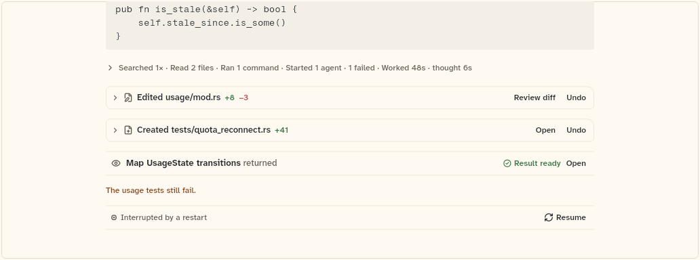
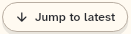

# TranscriptList

The scrolling column of a chat's transcript. It follows the tail, restores an anchor, and draws each item with `TranscriptItemView`. This sheet also covers `TranscriptItemView` (the item dispatcher in `transcript_item.dart`), `TranscriptActions` (the host's callbacks) and `JumpToLatestButton`.

```dart
import 'package:agent_kit/agent_kit.dart';
```

## Demo

<picture>
  <source media="(prefers-color-scheme: dark)" srcset="shots/transcript_list-dark.png">
  
</picture>

*Transcript at its tail: the Components specimen list (380 px high), with no-op callbacks for review, undo, open file, open output and open child, and an `InterruptedNotice` as `trailing`. The list is following the tail, so the crop shows its last items.*

<picture>
  <source media="(prefers-color-scheme: dark)" srcset="shots/jump_to_latest_button-dark.png">
  
</picture>

*Jump to latest: the pill on its own, as the specimen builds it. In a list it shows only while the list is not following the tail (`_following` is false), 12 px above the bottom edge. The lines above it fade out.*

## Parameters

**TranscriptList**

| Parameter | Type | Notes |
|---|---|---|
| `items` | `List<TranscriptItem>` | The transcript in order (`ChatSnapshot.items`). Default `const []`. |
| `entries` | `List<TimelineEntry>?` | Rows the host draws itself. When set, `items`, `actions` and `layout` are not used. |
| `actions` | `TranscriptActions` | Passed to every item. Default `const TranscriptActions()`. |
| `controller` | `TranscriptController?` | Reads `following` and `anchor`; drives `jumpToLatest` and `restore`. |
| `initialAnchor` | `TranscriptAnchor?` | Where to open instead of the tail. When set, following starts off. |
| `plan` | `List<PlanItem>` | Default `[]`. When not empty, a `PlanChecklist` is the first row, before `leading`. |
| `inserts` | `List<TranscriptInsert>` | Extra rows placed after an item id. An unknown or null id puts the row at the end. |
| `leading` | `Widget?` | Shown before the first item, after the plan. |
| `trailing` | `Widget?` | Shown after the last item. |
| `layout` | `TurnLayout` | Default `chronological`. `grouped` orders each turn as text, edits, activity, then notices. |
| `contentWidth` | `double` | Default 720. The width of the centred content column. |
| `rowGap` | `double` | Default 14. Space above every row after the first, and above `trailing`. |
| `gapBefore` | `double? Function(String? previousId, String id)?` | Overrides the gap above row `id`. Null keeps `rowGap`. |
| `gutter` | `double` | Default 16. Space left and right inside `contentWidth`. |
| `followThreshold` | `double` | Default 24 px. Distance from the bottom that still counts as at the bottom. |
| `padding` | `EdgeInsets?` | Default top 20 when compact, 28 otherwise; bottom 40. |
| `scroll` | `ScrollController?` | The host's own controller. The list never disposes it. |
| `viewportKey` | `GlobalKey?` | Key of the scrolling viewport, for a host that measures rows. |

**TranscriptItemView** (`transcript_item.dart`)

| Parameter | Type | Notes |
|---|---|---|
| `item` | `TranscriptItem` | Required, positional. Picks the widget: `UserMessage` gives `UserBubble`, `AssistantMessage` gives `AssistantProse`, `SystemLine` gives `SystemLineView`, `NoticeLine` gives `NoticeLineView`, `ActivityGroup` gives `ActivityGroupView`, `FileEdit` gives `FileEditRow`, `ChildResult` gives `ReturnLine`, `CompactionItem` gives `CompactionMarker`, `ChildQuestionItem` gives `ChildQuestionRow`, `InterruptedItem` gives `InterruptedNotice`. |
| `actions` | `TranscriptActions` | Default `const TranscriptActions()`. |

**TranscriptActions** (every callback is optional; a control whose callback is null is not drawn)

| Parameter | Type | Notes |
|---|---|---|
| `markdown` | `MarkdownRenderer` | Default `LeanMarkdownRenderer()`. Renders assistant prose. |
| `onReviewDiff` | `ValueChanged<FileEdit>?` | "Review diff" on an edit row. |
| `onUndo` | `FutureOr<void> Function(FileEdit)?` | "Undo" on an edit row. |
| `onOpenFile` | `ValueChanged<FileEdit>?` | "Open" on a created file's row, and on every edit when `openEveryEdit` is set. |
| `onOpenOutput` | `ValueChanged<ToolRow>?` | "Open full output" on an exec row. |
| `onOpenChild` | `ValueChanged<String>?` | Gets the child's id. Used by spawn rows, return lines and the child question's "Open child". |
| `onLinkTap` | `ValueChanged<String>?` | A markdown link was tapped. |
| `onRefTap` | `ValueChanged<KitRef>?` | A context chip on a user message was tapped. |
| `onViewContext` | `VoidCallback?` | "View" on a compaction marker. |
| `onAnswerChildQuestion` | `void Function(String childId, String questionId, String text)?` | "Send answer" of a child question. Null leaves "Answer yourself" out. |
| `onResume` | `VoidCallback?` | "Resume" on an interrupted notice. |
| `onRewind` | `ValueChanged<UserMessage>?` | "Rewind from here" on a user message. Null leaves it out. |
| `summaryOf` | `ActivitySummaryBuilder?` | Replaces the summary line of activity groups. |
| `activityFooter` | `Widget? Function(ActivityGroup)?` | A host disclosure under an open activity group. |
| `openEveryEdit` | `bool` | Default false. Shows "Open" on every edit row. |
| `now` | `DateTime?` | Replaces the wall clock for waiting times. |

**JumpToLatestButton**

| Parameter | Type | Notes |
|---|---|---|
| `onTap` | `VoidCallback` | Required. The list passes a call to its own jump-to-latest. |
| `label` | `String` | Default `'Jump to latest'`. |
| `color` | `Color?` | Fill of the pill. Default `surface`. |

## Theme roles

- `TranscriptList`: `ink` (fade mask colours), `surface` and `thread` (the pill's default fill and border, from `JumpToLatestButton`), `colors.seam` (pill shadow), `radii.pill`, `typeScale.uiSmall`. Also `Motion` (`Motion.of(context).reduced`, `Motion.standard`, `Motion.ease`).
- `JumpToLatestButton`: `surface`, `thread`, `colors.seam`, `radii.pill`, `ink`, `typeScale.uiSmall`.
- `TranscriptItemView` and `TranscriptActions` read no roles; the item widgets read their own.

## Size classes

- `TranscriptList` wraps itself in a `SizeClassBuilder`, so the class comes from the list's own width. It is `compact` below `theme.sizeMedium` and `expanded` from `theme.sizeExpanded` (values from the theme, set in bb_ui; not checked in this repo). Its only use is the top padding: 20 when compact, 28 otherwise.
- The content column is capped at `contentWidth + 2 × gutter` (752 px by default) and centred.
- Item rows read the class through `sizeClassOf`, which finds this list's `SizeClassBuilder`. See the item sheets.
- `JumpToLatestButton` does not read the size class. It reads `isTouch` (`formFactor == FormFactor.mobile`): padding 9 px vertical on touch, 6 px otherwise, and the list reserves a larger zone at the bottom on touch (38 px against 30 px).

## Accessibility

- `JumpToLatestButton`: `Semantics(button: true, label: label, excludeSemantics: true)`.
- `_jumpToLatest` jumps without animation when `Motion.of(context).reduced` is true; otherwise it animates to the bottom over `Motion.standard`.
- No other Semantics, labels or key handling in `transcript_list.dart` or `transcript_item.dart`.

## Gallery and tests

- Gallery scene: Components (`GalleryScene.components`). Specimen: `TranscriptSpecimens` in `apps/gallery/lib/components/transcript.dart` (the list and "Jump to latest"); mounted by `apps/gallery/lib/src/components_scene.dart`.
- Golden: `apps/gallery/test/component_shots_test.dart` writes `transcript_list` (the first `TranscriptList` in the scene) and `jump_to_latest_button` (the first `JumpToLatestButton`), light and dark. `apps/gallery/test/scenes_golden_test.dart` covers the whole Components sheet (`components_1000_<theme>.png`).
- Other tests, in `packages/agent_kit/test/transcript/transcript_test.dart`:
  - "follows the tail, lets go on scroll, jumps back" (line 500);
  - "restores an anchor" (539);
  - "the hosts scroll controller and viewport key are used" (590);
  - "grouped layout puts text, edits, then activity" (614);
  - "renders every item kind" (645);
  - "draws the plan, and inserts after their item" (671).
- `packages/agent_kit/test/transcript/transcript_golden_test.dart` renders the "turn" and "states" sheets at 390 and 1000 px (`packages/agent_kit/test/goldens/transcript_turn_*.png`, `transcript_states_*.png`); the states sheet includes `JumpToLatestButton`.
- `packages/agent_kit/test/compositions/agent_chat_pane_test.dart` drags a `TranscriptList` in the chat pane (lines 205, 219, 260).
