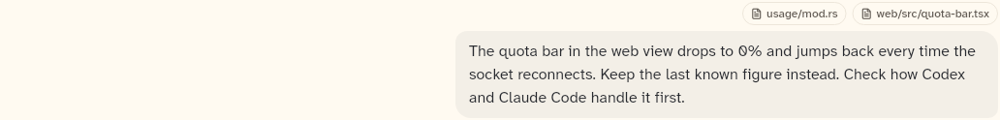

# UserBubble

The user's message: context chips above a right-aligned text bubble, with an optional "Rewind from here" action.

```dart
import 'package:agent_kit/agent_kit.dart';
```

## Demo

<picture>
  <source media="(prefers-color-scheme: dark)" srcset="shots/user_bubble-dark.png">
  
</picture>

*Idle: a message with two context chips, as the Components specimen builds it (`UserBubble(_user, onRefTap: ...)`). No `onRewind` is passed, so no rewind action is drawn.*

## Parameters

| Parameter | Type | Notes |
|---|---|---|
| `message` | `UserMessage` | Required, positional. The bubble shows `text`. The chips are the `refs` whose `start` is null. |
| `onRefTap` | `ValueChanged<KitRef>?` | Called when a chip is tapped. Without it the chips are drawn but are not buttons. |
| `onRewind` | `VoidCallback?` | "Rewind from here". Not drawn when null. |

## Theme roles

`surface2` (bubble fill), `radii.panel` (bubble corners), `typeScale.body` and `ink` (message text), `typeScale.uiSmall` and `muted` (rewind label and chip text), `colors.borderSubtle` (chip border), `formFactor` (touch layout).

## Size classes

Does not read the size class. It reads `formFactor` (touch when `FormFactor.mobile`).

- Bubble width: at most 560 px and at most 85% of the available width (`math.min(560, width × .85)`).
- Rewind placement, with a bounded width and a pointer: left of the bubble when `width − bubble − 6 ≥ 130` (`_rewindRoom`), so the layout does not move.
- Otherwise, and always on touch: under the bubble, right-aligned, shown at all times on touch.

## Accessibility

- Rewind: `Semantics(button: true, label: 'Rewind from here', excludeSemantics: true)`. A `Focus` widget tracks focus. With a pointer the action is hidden (`Opacity` 0) until the pointer is over the message or the action has focus.
- Context chip: `Semantics(button: tap != null, label: ref.label, excludeSemantics: true)`.
- No other Semantics or key handling in `messages.dart`.

## Gallery and tests

- Gallery scene: Components. Specimen "User message, with context chips" in `TranscriptSpecimens` (`apps/gallery/lib/components/transcript.dart`). The rewind action has no specimen.
- Golden: `apps/gallery/test/component_shots_test.dart` writes `user_bubble` (the first `UserBubble` in the scene), light and dark.
- Other tests:
  - `packages/agent_kit/test/transcript/transcript_test.dart`, "user bubble, chips and tap" (line 91).
  - `packages/agent_kit/test/compositions/agent_chat_pane_test.dart`, '"Rewind from here" on a user message calls the backend' (line 213), and the case that expects no "Rewind from here" text (line 263). The chat pane passes `onRewind` only when the backend has `KitCapability.rewind` (`agent_chat_pane.dart:380`).
  - Transcript goldens in `packages/agent_kit/test/goldens/transcript_turn_*.png` and `transcript_states_*.png`.
