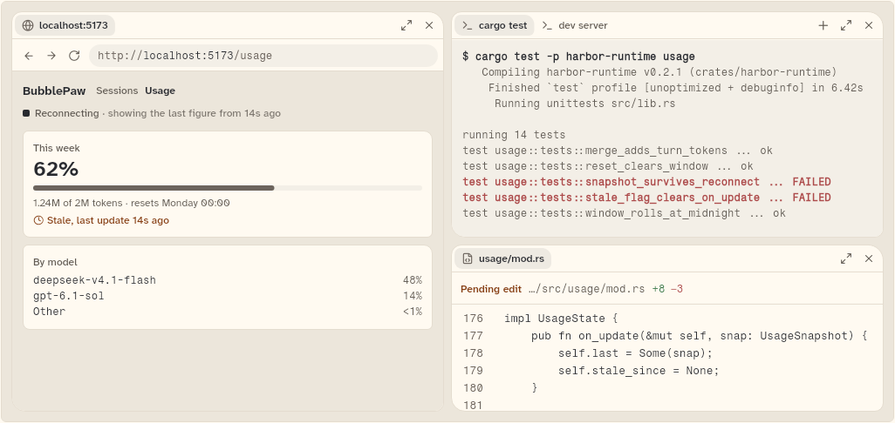
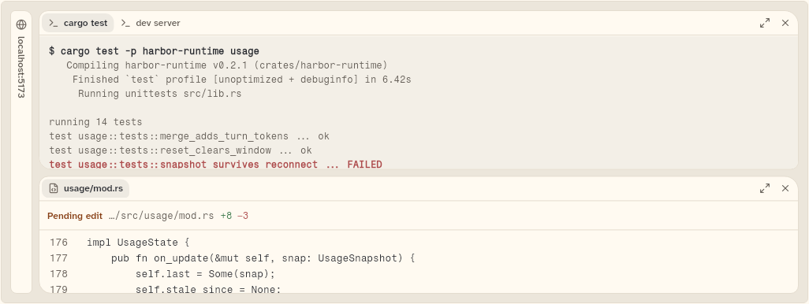
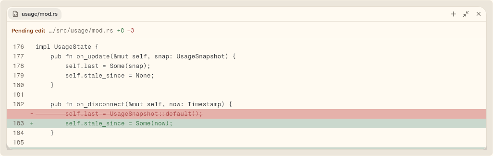
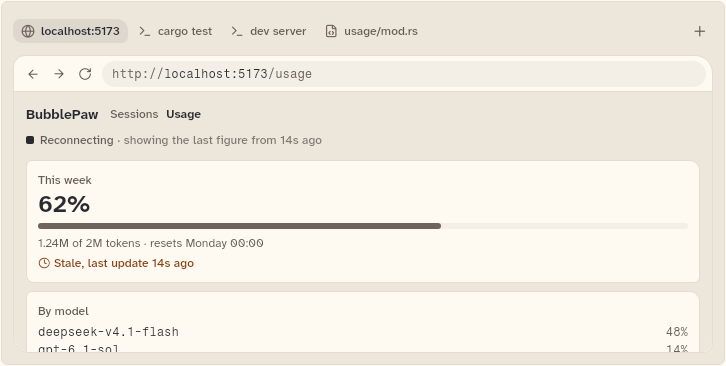
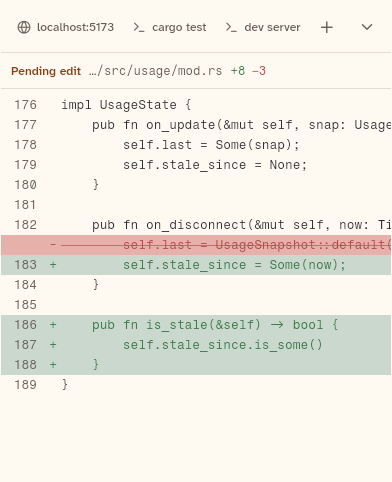
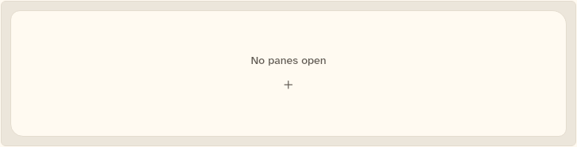

# AgentWorkspace

The tiling pane area beside the chat: a split tree of panes with dividers, tabs, maximise and close on each pane, collapse to edge tabs, drag to dock, and a single tabbed column or a full-screen sheet at the narrower size classes. The kit owns the layout and the chrome. The host supplies what each pane shows through `paneBuilder`. Also documented here: `WorkspaceController`, the layout model it holds, and the geometry that places it.

```dart
import 'package:agent_kit/agent_kit.dart';
```

## Demo

<picture>
  <source media="(prefers-color-scheme: dark)" srcset="shots/agent_workspace_expanded-dark.png">
  
</picture>

*Expanded, 1000 by 460. The gallery's live layout: a browser pane (`localhost:5173`, the Usage page) on the left full height; a terminal pane on the top right with the tabs "cargo test" (active) and "dev server"; a file pane on the bottom right showing `usage/mod.rs` with a "Pending edit" line (+8 −3) and lines 176 to 181. Each pane header has its tabs, a "+" (on the last pane that can split), maximise and close.*

The other five shots show the same layout at other sizes and states.

<picture>
  <source media="(prefers-color-scheme: dark)" srcset="shots/agent_workspace_collapsed-dark.png">
  
</picture>

*Collapsed, 1000 by 360. The browser is folded to a vertical edge tab labelled "localhost:5173" at the left. The terminal (top) and the file pane (bottom) take the rest. The collapsed pane keeps its content off screen.*

<picture>
  <source media="(prefers-color-scheme: dark)" srcset="shots/agent_workspace_maximised-dark.png">
  
</picture>

*Maximised, 1000 by 300. The file pane fills the area. Its header button reads "Restore pane" (the minimise glyph), so the other panes are hidden until it is restored.*

<picture>
  <source media="(prefers-color-scheme: dark)" srcset="shots/agent_workspace_medium-dark.png">
  
</picture>

*Medium, 700 by 340. One column. The bar holds the pane tabs (localhost:5173, cargo test, dev server, usage/mod.rs) and a "+" at the right. The front pane is the browser, the tab last touched. Selecting a tab shows that pane.*

<picture>
  <source media="(prefers-color-scheme: dark)" srcset="shots/agent_workspace_compact-dark.png">
  
</picture>

*Compact, 390 by 480, shot with 1 px padding. A full-screen sheet with a 52 px bar. The bar scrolls sideways, and the tab of the front pane (usage/mod.rs, whose diff fills the sheet) is past the right edge, so only the first three tabs show. The down chevron is "Back to chat" (`wp-sheet-close`), which calls `onClose`.*

<picture>
  <source media="(prefers-color-scheme: dark)" srcset="shots/agent_workspace_empty-dark.png">
  
</picture>

*Empty, 700 by 160. The text "No panes open" and a "+" button (labelled "Add pane") that opens the + menu. The shot is built from `WorkspaceController()`, with no layout.*

## Parameters

| Parameter | Type | Notes |
|---|---|---|
| `controller` | `WorkspaceController` (required) | Holds the `WorkspaceLayout`. The workspace rebuilds when it notifies. |
| `kinds` | `List<WorkspaceKind>` (required) | The kinds of pane, in the order of the + menu. `WorkspaceKind.standard` is Browser, Terminal, File and Activity. |
| `paneBuilder` | `WorkspacePaneBuilder` (required) | `Widget Function(BuildContext, WorkspaceTab)`. Builds what a pane shows from its tab's `kind` and `id`. |
| `open` | `bool` | Default `true`. Compact only: whether the full-screen sheet is up. When false the sheet slides off and is excluded from semantics and pointer input. |
| `onClose` | `VoidCallback?` | Compact only: the sheet's "Back to chat" chevron. |
| `sizeClass` | `SizeClass?` | Overrides the size class. By default the workspace measures its own width. `AgentWorkbench` passes the area's class. |

`WorkspaceKind` has `id`, `label` and `icon`. Its four `static const`s are `browser`, `terminal`, `file` and `activity`, plus `context` (id `context`), which `AgentWorkbench` adds to the + menu when the backend has the context capability. Kinds the host does not list still show: an unknown kind is labelled by its id with a panel icon.

## Behaviour

- Layout by size class (`SizeClassBuilder`, thresholds from `theme.sizeMedium` and `theme.sizeExpanded`; `SizeClass.forWidth` defaults to 600 and 1000):
  - Expanded: the split tree, with dividers and a header on each pane.
  - Medium: one column. A 36 px bar of pane tabs (horizontally scrolling) above the front pane. The pane has a 1 px seam border and rounded corners.
  - Compact: the same tab bar at 52 px, a bottom rule and a "Back to chat" chevron, filling the screen. The pane has no border.
- Empty layout: a panel with "No panes open" and an "Add pane" button.
- Pane header (32 px): tabs (`wp-tab-<tab id>`), then "Add pane" (`wp-add-<leaf id>`, only on the last pane that can split), "Maximise pane" or "Restore pane" (`wp-max-<leaf id>`), and "Close pane" (`wp-close-<leaf id>`). Dragging the header area docks the pane.
- Dividers (`wp-divider-<split id>-<index>`): a drag resizes the two neighbours. A drag past a pane's minimum previews hiding it (`wp-snap-hint`) and then collapses it. A double-click evens the split. Focused dividers take arrow keys to nudge (Up and Down for columns, Left and Right for rows), and Enter evens the split.
- Edge tabs (`wp-edge-<node id>`): a collapsed pane or split shows a tab at its edge, labelled with the tabs it holds, that restores it at its previous size.
- Dock by drag: a dragged tab shows a ghost (`wp-dock-ghost`) and a preview (`wp-dock-preview`). Five zones on each pane: left, right, top and bottom split the pane; the centre adds the tab to its group. A drop within about 22 px of the workspace edge makes a full-height or full-width split.
- The + menu (`wp-menu`, barrier `wp-menu-barrier`) lists `kinds` (`wp-menu-<kind id>`). Choosing one adds a pane of that kind beside the pane the menu opened from (`besideLeaf`).
- Keyboard: Escape cancels an active dock drag, a divider drag or an open + menu. The workspace has a focus node for these keys.
- Pane state: all pane contents sit in one flat stack keyed by tab id (`wp-content-<tab id>`), so a pane keeps its state when it is docked elsewhere or collapsed.

## Theme roles

Surfaces and borders: `surface`, `seam`, `radii.panel`, `colors.seamHover` (shadow of a maximised pane). Text: `muted` (the empty-state line) and `typeScale.ui` for it. Motion: `motion.sheet` (compact slide), `motion.ease` (its curve). Layout: `layout.paneMinWidth`, `layout.paneMinHeight` and `layout.edgeTab` set the minimums and edge tab size (these values come from `bb_ui`'s `KitLayout` and are not defined in this repository). Icons: `WorkspaceIcons` (Lucide globe, terminal, file-code, activity, layers, plus, chevron down and the maximise pair).

## Size classes

Expanded: tree. Medium: tabbed column. Compact: sheet. The class follows the nearest size-class container, not the window: a workspace inside a narrow column takes the compact layout even on a wide window (test "the class follows the container, not the window").

## Accessibility

- The workspace is a `Semantics` container labelled "Workspace".
- The compact sheet is excluded from semantics while closed (`ExcludeSemantics`) and ignores pointers.
- Dividers are labelled "Resize panes" and respond to arrow keys and Enter.
- Edge tabs read "Show <label>". Header buttons are `Semantics` buttons with their label and an `AppTooltip`.
- The + menu is labelled "Add pane".
- Reduced motion: the compact slide and the dock preview's movement use `Duration.zero` when `BbTheme.reducedMotion(context)` is true.

## Layout model and controller

`WorkspaceController` holds a `WorkspaceLayout` and notifies on each change. Its operations are `addPane`, `addTab`, `split`, `closeTab`, `closeLeaf`, `activate`, `dock`, `resize`, `evenSplit`, `collapse`, `restore`, `unfold`, `toggleCollapse`, `maximise`, `unmaximise` and `toggleMaximise`. No-op operations do not notify. `toJson`, `encode` and `decode` (and `WorkspaceController.fromJson`) save and restore the layout as JSON, so a host can persist it.

`layoutWorkspace` (in `workspace_geometry.dart`) places a layout in a size and returns a `WorkspaceGeometry`: the rectangles of nodes and leaves, the dividers and the edge tabs. `WorkspaceMetrics` holds the minimum pane size, the divider thickness and the edge tab size used for it.

## Gallery and tests

- Gallery: Components (`GalleryScene.components`). `WorkspaceSpecimens` in `apps/gallery/lib/components/workspace.dart` builds six stages: `_live` (1000 by 460), `_collapsed` (1000 by 360, the browser collapsed), `_maximised` (1000 by 300, the file pane maximised), `_medium` (700 by 340), `_compact` (390 by 480, sheet) and `_empty` (700 by 160). The pane contents come from `galleryPaneBuilder` (fake browser, terminal, file and activity panes).
- Golden: `apps/gallery/test/component_shots_test.dart` writes `agent_workspace_expanded`, `_collapsed`, `_maximised`, `_medium`, `_compact` (1 px padding) and `_empty`, each `_light.png` and `_dark.png`, into `docs/components/workspace/shots/`.
- `packages/agent_kit/test/workspace/agent_workspace_test.dart`:
  - Divider: "stops at the minimum, previews, then collapses past it"; "the other side collapses the same way"; "a drag inside the limits resizes without collapsing"; "double-clicking evens the split"; "arrow keys nudge a focused divider".
  - Edge tab: "restores the pane at its previous size"; "a collapsed pane keeps its state"; "a column collapses to a horizontal tab"; "an edge tab of an auto-folded pane unfolds it"; "a pane folds by itself when there is no room".
  - Dock by drag: one test per zone ("into the … zone of a pane") and per outer edge; "a short move is a click, not a drag"; "Escape cancels the drag"; "dropping a lone pane on itself shows no target".
  - Size class: "expanded is the tree, medium one tabbed column, compact a sheet"; "the class follows the container, not the window".
  - Pane chrome: "the + menu lists the host kinds and adds a pane"; "only the last pane that can split shows +"; "+ moves to the pane that still has room"; "a tap outside closes the menu"; "maximise fills the area and restores"; "close removes the pane"; "tabs of a group switch the pane that shows"; "an empty workspace offers the + menu".
- `packages/agent_kit/test/workspace/workspace_model_test.dart`: groups "add and split", "close", "dock", "resize, even, collapse, maximise", "unfold", "JSON", "controller" and "geometry".
- `packages/agent_kit/test/workspace/workspace_golden_test.dart` (tag `golden`): "tree", "collapsed browser", "dock drag", "divider snap", "add menu", "medium" and "compact", each in light and dark. They write `packages/agent_kit/test/goldens/workspace_{tree_1000, collapsed_1000, dock_1000, snap_1000, menu_1000, medium_700, compact_390}_{light,dark}.png`.

## Related types

- `WorkspaceController` (`workspace_controller.dart`): the holder and the operations above.
- `WorkspaceLayout` (`workspace_model.dart`): the immutable layout (`root`, `maximised`, `front`), with the operations (`addPane`, `dock`, `resize`, `collapse`, `maximise` and so on) and `toJson` and `fromJson`.
- `WorkspaceNode`, with `WorkspaceLeaf` (a pane: tabs and an active tab) and `WorkspaceSplit` (a split: an axis, children and weights). A split's children may be collapsed.
- `WorkspaceTab` (`id`, `kind`, `title`), `SplitAxis` (`row`, `column`), `DockSide` (`left`, `right`, `top`, `bottom`), `DockZone` (the four sides and `center`) and `DockTarget` (a leaf and a zone, or an outer edge).
- `WorkspaceKind`, `WorkspacePaneBuilder` and `WorkspaceIcons` (`agent_workspace.dart`).
- `WorkspaceGeometry`, `DividerSpec`, `EdgeTabSpec`, `WorkspaceMetrics` and `layoutWorkspace` (`workspace_geometry.dart`).
